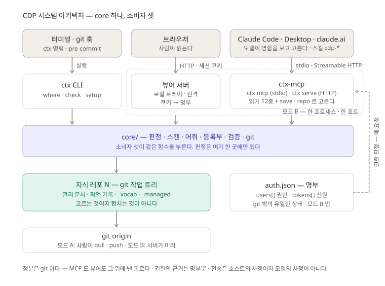

# CDP MCP 설계서 v1.1

2026-09-21 개정 · 현재 v0.8.0 · 근거 문서 [`개념정리_MCP`](개념정리_MCP.md) ·
검토 경위 [`docs/dev/MCP_적용검토_설계서_v0.1`](../dev/MCP_적용검토_설계서_v0.1.md)

> `core/` 의 세 번째 소비자 `ctx-mcp` 를 만든다. 전송이 둘이다 — **모드 B(서버 · HTTP)** 가
> 기본이다. 서버가 지식 레포 N 개를 들고 읽기 · `save` · 관리 서비스를 한 프로세스에서 낸다.
> **모드 A(로컬 · stdio)** 는 서버를 세울 수 없는 곳(§3.0)에서 작업 PC 의 clone 을 읽는다.
> 모드 B 의 웹 화면은 **관리 서비스**다 — 읽기 · 레포 전환 · 설치 관리까지 한다(§6).
> 두 모드 모두 **서버 하나가 레포 여럿**을 들고 부르는 쪽이 고른다(§2.9). 도구 · 리소스 ·
> 명함 · 판정 코드는 두 모드가 같다.

> **실측으로 고친 것**(2026-09-21, 10.10.20.188 설치 중) — ① Origin 검사를 루프백에서
> **같은 출처**로(모드 B 화면이 전부 403 이었다) ② `/kit` 을 쿠키도 받게(내려받기가
> 401 JSON 을 파일로 떨궜다) ③ 설치 대장 등록·삭제를 `write` 로(§6.7.2)
> ④ `--repos` 가 먹지 않고 `user set` 이 레포를 지우던 것 ⑤ 모드 B 의 동기화
> 화면을 없앴다(버튼이 전부 404 였다 · §6.6.3) ⑥ 꾸러미에 실행기를 넣고 `kit/` 을
> 한 단 내렸다 — 푸는 순간 `CLAUDE.md` 가 덮이던 것(§6.7.3).
>
> **v1.1 개정** — ① 모드 A 를 폐쇄망 전용으로 좁혔다(§3.0) ② 서버 하나가 레포 N 개를
> 다루고 호출 쪽이 고른다(§2.9) ③ 설치 절차를 호스트별로 묶었다(§5) ④ 화면의 원격
> 서비스화를 범위에 넣었다(§6) ⑤ 그것을 **관리 서비스**로 고쳐 부르고 작업 레포 설치를
> 맡긴다(§6.7).

---

## 0. 범위 · 용어

| 용어 | 뜻 |
|---|---|
| 호스트 | Claude Code · Claude Desktop · claude.ai 등 MCP 클라이언트 |
| 서버 | `ctx-mcp` — 이 문서가 만드는 것 |
| 모드 A | `ctx mcp` · stdio · 작업 PC · 레포 = 로컬 clone · 쓰기는 스킬 + git 훅. **서버를 세울 수 없는 곳 전용**(§3.0) |
| 모드 B | `ctx serve` · Streamable HTTP · 서버 1대 · 쓰기는 `save` 도구 · 관리 서비스 동거(§6). **기본** |
| 레포 | **지식 레포** 하나. 폴더명이 이름이다. 두 모드 모두 서버 하나가 N 개를 든다(§2.9) |
| 작업 레포 | 사람이 코드를 짜는 git 레포. 지식 레포가 **아니다.** 여기에 `.mcp.json` · 스킬 · `CLAUDE.md` 블록이 깔린다 |
| 관리 서비스 | 모드 B 의 웹 화면. 문서 읽기 + 레포 전환 + **작업 레포 설치 관리**(§6). 예전 이름 "원격 뷰어" |
| 로컬 뷰어 | 모드 A PC 의 트레이 앱. 지금 그대로 남는다 |
| 기본 레포 | `repo` 인자를 생략했을 때 쓰이는 레포. 클라이언트가 설치 때 정한다(§2.9) |
| 명함 | 도구의 `description` + `inputSchema` |
| 단위 | 작업 기록 1건 + 파생 섹션 갱신 + 어휘 등재 — 한 커밋 |

범위 밖: **레포 간 조인**(한 질문이 두 레포의 좌표를 엮는 것 — 레포는 고르는 대상이지
합치는 대상이 아니다) · 문서별 권한 · OAuth 서버 구현 · 관리 서비스에서 지식 레포를 고치는 것(§6.5).

---

## 1. 구조



`core/` 하나에 소비자가 셋이다 — CLI · 화면(로컬 뷰어 · 관리 서비스) · `ctx-mcp`. 셋이 같은 함수를 부르므로 판정이
한 곳에만 있다. 정본은 git 이고, git 밖의 상태는 `auth.json` 명부 하나뿐이다(§4.4).


```
core/                          판정 · 스캔 · 어휘 · 등록부 · 검증 · git         (변경 없음)
viewer/bin/ctx-cli.mjs         CLI  — 서브커맨드 mcp · serve 추가
viewer/bin/ctx-mcp.mjs         신설 — 도구 · 리소스 · prompts 정의 + 핸들러 (전송 무관)
viewer/bin/ctx-mcp-serve.mjs   신설 — 모드 B: HTTP 서버 · 레포 저장소 · 인증 · save · 관리 서비스 라우트
ops/lib/build-ctx.mjs          번들에 위 둘과 SDK 포함 → bin/ctx.mjs 하나
```

| | 모드 A | 모드 B |
|---|---|---|
| 언제 | 서버를 세울 수 없다 — 폐쇄망 · 반입 PC · 1인 (§3.0) | 그 밖의 전부 · **기본** |
| 프로세스 | 호스트가 세션마다 띄운다 | 상주 (LaunchAgent / systemd) |
| 전송 | stdio | Streamable HTTP (stateless) |
| 레포 | `--root` 아래 clone N 개 (하나면 그 폴더) | `<root>/<name>/` 작업 트리 N 개 |
| 인증 | 없음 (자식 프로세스) | Bearer 토큰 · TLS 는 프록시 |
| 도구 | 읽기 12 | 읽기 12 + `save` |
| 쓰기 경로 | 스킬 → Edit/Write → git commit → 훅 `ctx check` | 스킬 → `save` → 서버 검사 → 커밋 → 미러 |
| 훅 | 그대로 | 없음 |
| 설치 | `ctx setup` 이 `.mcp.json` 을 PC 마다 쓴다 | `ctx setup --server` 가 URL + 토큰 헤더를 쓴다 |
| 런타임 | Node 또는 `cdp.exe` (shim) | Node ≥ 20 |
| 화면 | 로컬 뷰어 — 트레이 앱 (루프백) | **관리 서비스** — 같은 프로세스가 `/` 로 낸다(§6) |

---

## 2. 공통 — 서버 정의

### 2.1 식별

| 필드 | 값 |
|---|---|
| `serverInfo.name` | `cdp` |
| `serverInfo.version` | `BUILT` (= `ctx version` 의 번들 시각) |
| `capabilities` | `tools` · `resources` (templates 포함) · `prompts` (§2.5 조건부) |
| `instructions` | 아래 문단. 레포 줄은 서버가 실제 목록으로 채운다 |

```
지식 레포의 도구다. 여기 있는 것이 정본이고 모델의 기억이 아니다.
· 다루는 레포 —                                  ← 서버가 레포마다 한 줄. 6개 이상이면 repos 도구로 대체
    ezipez  이지펠 단지 데이터 마트 · 팩터 · 배치
    dpms    DPMS 패키지 · 변환 규칙
  기본은 ezipez. 다른 레포면 repo 를 넘긴다. 어느 레포인지 모르면 match 가 찾아준다.
· 시스템의 지금 상태·결정 이유를 물으면 기억으로 답하지 않는다.
· 좌표를 말로 받았으면 match 로 확정 → where 로 상태 → section 으로 그 섹션만.
  이유는 where 가 준 작업 id 로 work 를 연다.
· 문서 전체를 읽지 않는다. "후속 있음"을 "덮임"이라 쓰지 않는다.
  파생 남음이면 그 사실을 답에 적는다.
· 기록·갱신은 cdp-save 절차로만 한다.           ← 모드 A: "쓰기 도구는 없다" 로 대체
```

### 2.2 도구 — 읽기 12종

입력은 JSON Schema(zod). 출력 필드는 `ctx <명령> --json` 과 동일한 객체다.

`version` 을 뺀 **모든 도구가 `repo?: string` 을 받는다** — 생략하면 기본 레포(§2.9).
출력에는 어느 레포로 답했는지 `repo` 가 항상 붙는다. 표에서는 이 둘을 생략했다.

| 도구 | 입력 | 출력 필드 | 명함 |
|---|---|---|---|
| `match` | `names: string[]` (1~20) | `[{ name, coord, kind: 이름\|값\|alias\|미등재, vocabLine, deprecated?, successor? }]` | 이름·alias·자유 표현을 정본 좌표로 대조한다. 테이블·화면·API·팩터·원천·용어를 말로 가리켰으면 좌표를 짐작하지 말고 먼저 이것으로 확정한다. `미등재` 는 어휘에 없다는 뜻이다 — 다른 좌표로 바꾸지 말고 그대로 보고한다. 기록(`save` · 편입)하는 중이면 "레포와 관계없는 말" 이 아니라 **등재 후보**다 — 그 기록이 정의하거나 바꾼 대상이면 좌표에서 빼지 말고 `vocab` 에 같이 보낸다. 폐기 좌표면 후속 좌표를 준다. `repo` 를 주지 않으면 **든 레포를 전부 대조**하고 결과마다 `repo` 를 적는다 — 그 값을 이후 도구에 그대로 넘긴다. 두 레포에 다 있으면 둘 다 보고한다(고르지 않는다) |
| `where` | `coord: string` · `limit?: int (기본 5, 최대 50)` | `{ coord, normalized?, registry, section: { doc, anchor, line, end, applied, state: ok\|derive-pending\|missing }, works: [{ id, date, title }], total }` | 좌표의 지금 상태가 어느 관리 문서 어느 섹션에 있나, 마지막으로 반영된 작업, 그 좌표를 건드린 작업들. "지금 어떻게 돼 있나"는 이것. alias 를 주면 정본으로 바꾸고 `normalized` 에 적는다. `state` 가 `derive-pending` 이면 그 섹션은 아직 최신이 아니다 — 답에 그 사실을 적는다. 등록부에 없는 타입(`registry: null`)은 관리 문서가 없는 것이 정상이고 작업 기록이 유일한 근거다 — 그래서 기록할 때 `touches` 가 그 좌표로 닿는 유일한 길이다. 채울 섹션이 없다는 것은 좌표를 뺄 이유가 아니다 |
| `section` | `coord: string` | `{ coord, doc, anchor, line, end, applied, heading, body, content }` | 관리 문서에서 그 좌표의 섹션 본문만 돌려준다. 문서 전체를 읽지 않는다. 섹션이 없으면 `body: null` 로 알린다. `content` 가 헤딩 줄과 applied 주석을 뺀 본문이다 — `save` 의 `sections[].body` 에는 이것을 고쳐 넣는다(헤딩을 넣으면 E_INPUT). `body` 는 헤딩부터 실린 원문 (2026-09-23 정정) |
| `work` | `id: string` | `{ id, frontmatter, body, path }` | 작업 기록 본문. "왜 그렇게 정했나"는 관리 문서가 아니라 여기 있다. 한 기록에 좌표가 여럿이고 좌표마다 그 뒤 사정이 다르다 — 문서 단위로 "덮였다"고 판정하지 말고 좌표별로 `where` 를 본다 |
| `search` | `words: string[]` (1~10) · `limit?: int (기본 12, 최대 50)` | `[{ coord, hits: [word], docs: [path], works: [id] }]` | 말 → 좌표 후보. `match` 가 미등재를 냈을 때의 폴백. 본문은 싣지 않는다 — 후보를 고른 뒤 `section` 으로 읽는다. 유사도 검색이 아니다: 걸리지 않으면 없는 것이다 |
| `derive` | — | `{ pendingDerive: [...], brokenSections: [...] }` | 파생이 남은 섹션과 깨진 섹션. 이것이 비어야 커밋된다. 치우는 것은 `cdp-managed` 절차 |
| `apply` | `coord: string` | `{ coord, doc, anchor, lines: [string] }` | 파생할 섹션에 붙일 변경 줄 초안. 파일은 고치지 않는다 — 고치는 것은 `cdp-save` 안에서 사람이 승인한 뒤 |
| `check` | — | `{ ok, errors, warnings, findings }` | 커밋 가능한가. 커밋 때 같은 검사가 돈다 — 이 도구로 미리 본다 |
| `sync` | — | 모드 A `{ mode: "local", remote, behind, ahead, hooksPath }` · 모드 B `{ mode: "server", head, mirror: ok\|lag\|off, kit: { hash, skills } }` | 원격과의 차이와 훅 설정 여부. 받지 않는다. 받을 것이 있으면 주입한 섹션이 최신이 아닐 수 있다고 알린다. 모드 B 의 `kit.hash` 는 **서버가 가진 스킬의 해시**다 — `CLAUDE.md` 블록의 `cdp:kit` 값과 다르면 이 PC 의 스킬이 낡았다는 뜻이다. 답에 적는다(§6.7) — 고치는 것은 담당자 PC 의 「일괄 갱신」 한 줄(설치기 `--update`), 팀원은 pull |
| `brief` | — | `{ lines: [string, string] }` | 두 줄 요약 — 절차와 살아 있는 레포 상태 |
| `repos` | — | `[{ name, title, default, coords, works, updated }]` | 이 서버가 든 지식 레포 목록. 레포를 모르겠으면 먼저 이것. 레포는 **고르는 것이지 합치는 것이 아니다** — 한 답에 두 레포를 섞지 않는다 |
| `version` | — | `{ built, mode, repos: [name] }` | 이 번들이 언제 만들어졌나. 번들이 낡으면 옛 판정을 낸다 |

명함은 도구당 3~4문장. `term` 은 `match` 에 흡수. `setup` · `index` · `sync --pull` 은 도구가 아니다.

`match` 만 레포를 가로지른다. 나머지 11종은 **레포 하나 안**에서만 돈다 — `repo` 가 확정되지
않으면 기본 레포로 답하고 `repo` 필드로 알린다. 기본 레포가 없는데 생략하면 `E_REPO`.

### 2.3 결과 형식 · 오류

```jsonc
// 성공
{ "content": [{ "type": "text", "text": "<JSON 문자열>" }], "structuredContent": { …같은 객체… } }
// 실패
{ "isError": true, "content": [{ "type": "text", "text": "{\"error\":{\"code\":\"E_CONFLICT\",\"message\":\"…\",\"detail\":{…}}}" }] }
```

| 코드 | 언제 | `detail` |
|---|---|---|
| `E_INPUT` | 스키마 위반 · 길이 초과 · 금지 문자 | 필드명 |
| `E_COORD` | 좌표 형식 오류 (`type:value` 아님 · `..` · 제어문자) | coord |
| `E_NOT_FOUND` | `work` id 없음 · 리소스 없음 | id / uri |
| `E_REPO` | 레포를 못 열음 · 스캔 실패 | path · cause |
| `E_AUTH` / `E_FORBIDDEN` | 모드 B — 토큰 없음/무효 · 권한 없음 | — |
| `E_EXISTS` | `save` — `work/<id>.md` 가 이미 있다 | id |
| `E_CONFLICT` | `save` — 섹션 `applied` 불일치 | `{ coord, expected, current }` |
| `E_CHECK` | `save` — `runBuiltinCheck` 오류 | `findings` |
| `E_GIT` | `save` — 커밋/미러 실패 | stderr 요약 |

### 2.4 리소스

| URI | 내용 | 목록 |
|---|---|---|
| `cdp://{repo}/section/{coord}` | `section` 과 같음 (text/markdown) | 템플릿 |
| `cdp://{repo}/work/{id}` | `work` 와 같음 | 템플릿 |
| `cdp://{repo}/doc/{name}` | 등록부의 관리 문서 전체. `description` = `"<repo>/<name> <크기>KB — 섹션 리소스를 우선 쓴다"` | 정적 (레포 × 등록부 문서 수) |
| `cdp://{repo}/index` · `/vocab` · `/managed` | `INDEX.md` · `_vocab.md` · `_managed.md` | 정적 (레포 × 3) |

작업 기록은 정적 목록에 올리지 않는다. `resources/list` 는 정적 항목만, `resources/templates/list` 는 템플릿 둘.
레포 이름은 URI 의 첫 조각이다 — 하나만 든 서버도 형식을 지킨다(`cdp://ezipez/index`). 정적
목록이 레포 수에 비례해 늘므로 **레포 6개 이상이면 `cdp://{repo}/doc` 만 템플릿으로 돌린다.**

### 2.5 prompts

| 이름 | 인자 | 돌려주는 메시지 |
|---|---|---|
| `load` | `coord` | ① `.claude/skills/cdp-load/SKILL.md` 의 §1~§5 규칙 ② `sync` 결과 ③ `match` ④ `where` ⑤ `section` 본문 — 하나의 user 메시지 |
| `brief` | — | `brief` 두 줄 + "절차는 스킬 · 이 대화창에서는 읽기만" 한 줄 |

노출 규칙 `--prompts auto|always|never` (기본 `auto`): `auto` 는 `initialize.params.clientInfo.name` 이 Claude Code 이면 **내놓지 않는다**(값은 §8 픽스처로 확정). 절차 문장은 스킬 파일을 **읽어서** 낸다 — 따로 적지 않는다.

### 2.6 레포 로딩 · 재스캔 · 직렬화

- 레포마다 독립된 캐시를 둔다 — 키는 레포 이름. 아래는 레포 하나에 대한 설명이다.
- 첫 요청에 `loadRepo(root)` → 메모리. 요청마다 스탬프 계산: `_vocab.md` · `_managed.md` · `docs/*.md` · `work/*.md` 의 `(count, max mtime)` + `.git/HEAD` 의 mtime. 스탬프가 바뀌면 다시 `loadRepo` 하고 객체를 **통째로 교체**한다(부분 갱신 없음). 감시(chokidar)는 쓰지 않는다.
- 읽기 도구는 교체된 객체를 읽을 뿐 상태를 바꾸지 않는다 — 동시 실행 허용.
- `save`(모드 B)는 레포당 뮤텍스. 직렬화된다.

> **정정(v0.12.0 · 동시 기록 검토 v0.1)** — 뮤텍스는 `core/lock.js` 하나이고 **미러 push 큐 · 「origin 과 맞추기」 · 「트리 되돌리기」 가 같은 줄에 선다**(D1 · D4 · D5). 실측(2026-09-25) — 다른 섹션 5건 · 10건 동시 `save` 전부 커밋 · 트리 깨끗 · 건당 약 1.8초 직렬(`loadRepo` 셋 — 다음 판). 캐시 둘(스탬프 · `Store`)의 정합은 맞았다 — `save` 직후 `section` 이 새 applied 를 준다. 스탬프의 `.git/HEAD` mtime 조각은 커밋에 반응하지 않는다(커밋은 `refs/heads/*` 를 쓴다) — `docs/` · `work/` 의 count + mtime 이 잡아 준다.
> 미러 push 는 **레포당 큐 하나**(`core/mirror.js`) — 도는 중에 또 오면 끝난 뒤 한 번 더. 전에는 fire-and-forget 이라 겹치면 origin 이 `cannot lock ref` 로 하나를 거절했다(실측 M11).

### 2.7 입력 검증 · 경로

- `coord`: `/^[a-z][a-z0-9_-]*:[^\s\x00-\x1f]{1,200}$/` · `..` 포함 금지.
- `id`: `/^\d{4}-\d{4}-[^\/\\\x00-\x1f]{1,120}$/`.
- 리소스 `name`: 등록부에 있는 파일명만. 파일 접근은 전부 `path.resolve(root, …)` 후 `root` 접두 검사.
- `words`·`names` 원소 ≤ 100자.

### 2.8 로그

| 모드 | 어디 | 무엇 | 안 적는 것 |
|---|---|---|---|
| A | stderr | 시작 · 레포 · 재스캔 · 오류 | 본문 · 검색어 · 좌표 |
| B | `<data>/logs/serve.log` 회전 3×1MB | 시각 · user · 도구명 · coord/id · ms · 결과 코드 | 본문 · 검색어(`search` 는 건수만) · 토큰 |

stdout 은 모드 A 에서 규약 전용 — `ctx-mcp.mjs` 는 `console.log` 를 쓰지 않는다.

### 2.9 레포가 여럿일 때

**서버 하나가 레포 N 개를 든다. 고르는 것은 부르는 쪽이다.** 레포마다 서버를 따로 등록하는
길도 있었으나 택하지 않았다 —

| | 레포마다 서버 (안 택함) | 서버 하나 + `repo` 인자 (택함) |
|---|---|---|
| 호스트 등록 | 레포 수만큼 | 하나 |
| 명함 비용 | 12 × N 개가 매 요청 컨텍스트에 | 12 + `repos` 한 줄씩 |
| 도구 이름 | `mcp__cdp-ezipez__where` | `mcp__cdp__where` |
| 잘못 부를 위험 | 도구 이름을 잘못 고른다 | 인자를 잘못 고른다 — **위험은 옮겨질 뿐 줄지 않는다** |
| 레포 추가 | PC 마다 `.mcp.json` 을 고친다 | 서버에 폴더만 둔다 |
| 권한 | 토큰을 서버마다 | 토큰 하나의 `repos` 로 (§4.4) |

명함 비용이 결정적이다. 레포 3개면 명함 36개가 **매 요청** 실린다. 그리고 레포를 늘릴 때마다
전원이 `.mcp.json` 을 고치는 것은 운영이 되지 않는다.

**잘못 고를 위험은 줄지 않는다** — 도구 이름에서 인자로 자리만 바뀐다. 그래서 짐작을 막는
장치를 규약이 아니라 **절차**에 둔다.

```
좌표를 말로 받았다 → match (repo 없이)  → 결과의 repo 를 그대로 들고
                   → where / section / work (repo 명시)
```

`match` 가 레포까지 확정해 주므로 모델이 레포를 짐작할 자리가 없다. 명함(§2.2)과
instructions(§2.1)에 이 순서를 박는다. `save` 는 **`repo` 필수**다 — 쓰기에서 기본값은 사고다.

**기본 레포** — 생략을 허용하는 이유는 대부분의 작업 레포가 지식 레포 하나만 본다는 것이다.

| 모드 | 기본 레포 |
|---|---|
| A | `--repo` 로 준 것 · 하나뿐이면 그것 · `.claude/cdp.json.knowledgeRepo` |
| B | URL 이 `/mcp/<name>` 이면 `<name>` · `/mcp` 면 토큰의 `repos` 가 하나일 때만 그것 |
| 둘 다 | 정해지지 않았는데 `repo` 를 생략하면 `E_REPO` — 임의로 고르지 않는다 |

**레포 간 조인은 하지 않는다.** `where`·`section`·`work` 는 레포 하나 안에서만 돈다. 좌표가
두 레포에 있으면 `match` 가 둘 다 보고하고 거기서 멈춘다 — 어느 쪽을 쓸지는 사람이 정한다.
레포가 다르면 어휘 · 등록부 · 파생 규칙이 다르고, 섞는 순간 판정의 근거가 무너진다.

---

## 3. 모드 A — 로컬 (stdio) · 폐쇄망

### 3.0 전제 — 언제 이 모드인가

모드 A 는 **기본이 아니다.** 조건은 하나다 —

> **레포를 들어 줄 서버를 세울 수 없다.** 그래서 PC 마다 clone 을 두는 수밖에 없다.

폐쇄망이 그 대표다. 다만 **"폐쇄망 = 모드 A" 가 아니다.** 망이 닫혀 있어도 그 안에 서버
한 대를 세울 수 있으면 모드 B 가 낫다 — 루프백 대신 사내 IP 에 바인드하고 프록시만
사내 인증서로 바꾼다. 모드 A 를 골라야 하는 진짜 자리는 **서버가 없는 폐쇄망 · 반입 노트북
한 대 · 혼자 쓰는 PC** 다.

**먼저 확인할 것 — 호스트가 모델에 닿는가.** MCP 는 호스트가 모델을 부를 수 있을 때만
성립한다(근거 문서 §0). 서버는 도구를 낼 뿐 모델을 들고 있지 않다. 망을 등급으로 나누면 —

| 등급 | 모델 API | git 원격 | 쓸 것 |
|---|---|---|---|
| 완전 에어갭 | 닿지 않는다 | 없음 | **MCP 가 성립하지 않는다.** `ctx` CLI 와 로컬 뷰어만 쓴다 |
| 모델만 개방 | 프록시로 허용 | 내부 git 서버 | 서버를 세울 수 있으면 **B**, 없으면 **A** |
| 사내망 | 허용 | 내부 git 서버 | **B** |
| 일반망 | 허용 | GitHub 등 | **B** |

첫 줄이 중요하다. 완전 에어갭에서는 이 설계서의 어느 모드도 켜지지 않는다 — 모델이 없는데
도구만 있는 것이기 때문이다. 도입 전에 **대상 망이 어느 줄인지 먼저 확정한다.**

폐쇄망이 실제로 바꾸는 것 —

| | 일반망 | 폐쇄망 |
|---|---|---|
| 반입 | 릴리스 URL · `npm i` | **파일 하나**(`bin/ctx.mjs` + `cdp.exe` + 스킬 kit)를 매체로 |
| 런타임 | Node 를 받으면 된다 | Node 가 없을 수 있다 → `cdp.exe` 경로가 **선택이 아니라 필수**(§9) |
| 갱신 | 받아서 덮는다 | 손으로 반입. 번들이 낡으면 옛 판정을 낸다 — `version.built` 가 90일 넘으면 `brief` 에 경고 한 줄 |
| git 원격 | origin | 내부 git 서버 · **없을 수도 있다**(`sync` 가 `remote: null` 을 낸다) |
| 훅 | 그대로 | 그대로 — 폐쇄망일수록 훅이 유일한 보증이다 |

### 3.1 실행 · 레포 해결

```
bin/ctx mcp [--root <폴더>] [--repo <경로>]… [--prompts auto|always|never]
```

| 플래그 | 뜻 |
|---|---|
| `--repo <경로>` | 지식 레포 하나. **여러 번 줄 수 있다.** 첫 번째가 기본 레포 |
| `--root <폴더>` | 그 폴더의 하위 디렉터리를 전부 레포로 본다(모드 B 의 `<root>` 와 같은 모양) |
| 둘 다 없음 | 지금까지와 같다 — `CDP_REPO` → `.claude/cdp.json` 상위 탐색 → **자기 위치**(`<repo>/bin/ctx.mjs` 의 부모). 레포 하나 · 그것이 기본 |

레포 이름은 폴더명이다. 이름이 겹치면 시작 시 stderr 경고 후 뒤엣것을 무시한다.
프로세스는 호스트가 띄우고 죽인다. 유휴 종료 없음.

### 3.2 설치 — `ctx setup` 산출물

`ctx setup <작업레포>` 가 기존 산출물(스킬 사본 · CLAUDE 블록 · `.claude/cdp.json`)에 더해 다음을 쓴다.

**`<작업레포>/.mcp.json`** — PC 마다 절대경로 · 커밋하지 않는다.

```jsonc
// macOS · Linux
{ "mcpServers": { "cdp": { "type": "stdio",
    "command": "/Users/kjsa/Documents/GitHub/ezipez_cdp/bin/ctx", "args": ["mcp"] } } }
// Windows
{ "mcpServers": { "cdp": { "type": "stdio",
    "command": "cmd", "args": ["/c", "C:\\work\\ezipez_cdp\\bin\\ctx.cmd", "mcp"] } } }
```

- 지식 레포를 둘 이상 붙이려면 `args` 를 `["mcp","--repo","<A>","--repo","<B>"]` 로 쓴다.
  `ctx setup <작업레포> --also <다른 지식레포 경로>` 가 그 줄을 만든다. **서버 항목은 하나로 유지한다** — 레포마다 `mcpServers` 키를 늘리지 않는다(§2.9).
- 기존 `.mcp.json` 이 있으면 `mcpServers.cdp` 키만 병합한다. 다른 서버는 건드리지 않는다.
- `.gitignore` 안내에 `.mcp.json` 한 줄을 추가한다(`cdp.json` 과 같은 이유).
- `inspect()` 가 `.mcp.json` 상태를 낸다: `command` 가 `cdp.json.knowledgeRepo` 와 일치 → 최신 · 불일치 → 갱신 필요 · 없음 → 미설치. 관리 > 작업 레포 화면에 열 하나 추가.
- `--dry` 는 `.mcp.json` 도 미리보기에 포함한다.

**`ctx setup --desktop`** — Claude Desktop 설정에 같은 항목을 병합한다.

| OS | 파일 |
|---|---|
| macOS | `~/Library/Application Support/Claude/claude_desktop_config.json` |
| Windows | `%APPDATA%\Claude\claude_desktop_config.json` |

키는 `mcpServers["cdp-<레포 폴더명>"]`. 파일이 없으면 만든다. 다른 키는 보존.

### 3.3 스킬 본문 규칙

스킬 머리의 `<repo>` 정의 줄 아래 한 문장 —

> `ctx` 호출은 MCP 도구 `cdp:*` 가 있으면 그것으로, 없으면 `<repo>/bin/ctx …` 로. 둘은 같은 함수다.

| 스킬 · 절 | 지금 | 도구 |
|---|---|---|
| cdp-load §0 | `ctx sync` | `sync` |
| cdp-load §2 · cdp-edit | `ctx where` → 섹션만 Read | `where` → `section` |
| cdp-load §5 | `ctx search` | `search` |
| cdp-work ① · cdp-save ② · cdp-import ③ | `ctx match` | `match` |
| cdp-save ④ · cdp-managed | `ctx derive` · `ctx apply` | `derive` · `apply` |
| 전부 | `git pull --ff-only` · Write/Edit · `git commit` | **그대로** |

훅(`.githooks/pre-commit`)은 CLI 를 그대로 쓴다.

### 3.4 에이전트

```yaml
tools: Read, Grep, Glob, mcp__cdp__match, mcp__cdp__where, mcp__cdp__section, mcp__cdp__work
```

셸 없이 정본만 읽는 에이전트의 `tools:` 형태. 어느 에이전트에 무엇을 줄지는 각 프로젝트가 정한다.

### 3.5 쓰기

없다. `save` 는 등록하지 않는다. 기록 · 파생 · 커밋 · push 는 스킬과 git 이 한다.

---

## 4. 모드 B — 서버 (HTTP)

### 4.1 실행

```
bin/ctx serve --root <레포들 폴더> [--bind 127.0.0.1] [--port 7374] --auth <auth.json>
              [--mirror] [--data <폴더>] [--prompts auto|always|never]
bin/ctx serve user  add|set|list --auth <auth.json> …                                # 명부 (§4.4.0)
bin/ctx serve token  --auth <auth.json> --user <이름> [--expires <일수>|never] [--note <메모>]
                     # 발급 · 1회 출력 · 기본 90일 · 권한은 명부에서 온다
bin/ctx serve token list   --auth <auth.json>                                        # 남은 일수 · 해시 앞 8자
bin/ctx serve token revoke --auth <auth.json> --user <이름>
```

Node ≥ 20 필수. `cdp.exe` 는 서버 모드를 지원하지 않는다. `--bind` 기본은 루프백 — 밖에서 오는 것은 프록시(§4.9)만.

### 4.2 레포 저장소

```
<root>/
  ezipez/      git 작업 트리 = 지식 레포 하나.  폴더명 = 레포 이름 = URL 조각
  dpms/
```

- 등록 = 폴더를 두는 것. `git clone <origin> <root>/<name>` 뒤 재시작 없이 **그 레포로 가는 첫 요청**부터 인식 — 모르는 이름이 오면 폴더를 다시 훑는다(2초에 한 번 · 2026-09-23). 전체 목록은 60초마다, 비어 있으면 즉시 갱신.
  **다른 길 하나** (2026-09-22 · 제품화 R6) — `ctx repo new <root>/<name> --package <이름>` 이 패키지 폴더를 복사해
  `git init` · `hooksPath` · 첫 커밋(훅) · `remote add` · `push` 까지 한다. 관리 서비스의 `POST /repos`(`write`)가 같은
  함수(`core/reponew.js`)를 부른다. origin 이 없는 패키지도 이제 서버에 설 수 있다.
- 서버가 **유일한 작성자**다. 서버 트리에서 사람이 커밋하지 않는다.
- `--mirror`: 커밋 뒤 `git push origin HEAD` 를 비동기로. 실패는 로그 + `sync.mirror = lag`. 사람은 origin 을 **읽기 전용으로 clone** 해 폴더로 읽는다.

> **정정(v0.12.0 · 동시 기록 검토 v0.1 D2 · D4 · D5 · D9)** — 미러 상태는 **다섯 값** `off · ok · lag · diverged · behind` 이고 판정은 `core/mirror.stateOf` 하나다. `lag` 에는 사유가 붙는다(`classifyPushError` — `non-ff · auth · net · protected · locked · no-upstream · unknown`). "서버가 유일한 작성자" 는 그대로지만 **origin 을 서버 밖에서 바꾸는 것(혼용)은 막지 않고 보이게 한다** — doctor 가 `ls-remote` 로 origin 이 앞선 것을 알아내고(fetch 없이), 콘솔 > 지식 레포의 **「origin 과 맞추기」**(재인증 · `runSync` 를 save 뮤텍스 안에서 · ff-only · `auth.log`)가 서버 트리를 맞춘다. 갈라졌으면(`diverged`) 거절하고 셸의 rebase 문장을 낸다 — 기계는 merge 하지 않는다(불변조건 10). 서버는 `save` 마다 fetch 하지 않는다(사내망 19.5초) — push 가 non-ff 로 거부될 때 한 번 fetch 해 `ahead/behind` 를 채운다.
> **더러운 서버 트리는 `save` 가 거절한다**(`E_GIT { reason: 'dirty', paths }`) — 전에는 사람의 미커밋 줄이 다음 `save` 의 작성자 이름으로 커밋됐다(실측 M8). 「트리 되돌리기」(재인증 · `checkout -- . && clean -fd` · 버린 경로를 `auth.log` 에)가 푼다. doctor 에 `트리` · `origin` · `push`(사유) 줄. 자동 push 확대(주기 · 시작 시)는 없다(불변조건 11).
- 레포마다 `.claude/skills/` · `CLAUDE.md` 등 kit 파일이 있어야 `prompts` 와 `GET /kit` 가 동작한다(모드 A 와 같은 레포 구성).

### 4.3 엔드포인트

| 메서드 · 경로 | 인증 | 내용 |
|---|---|---|
| `POST /mcp` | Bearer | MCP Streamable HTTP. **레포는 도구의 `repo` 인자로 고른다**(§2.9). 기본 레포는 토큰의 `repos` 가 하나일 때만 정해진다. stateless — 세션 id 없음. 응답은 JSON 또는 SSE(SDK 결정) |
| `POST /mcp/<name>` | Bearer | 같은 규약 · **`<name>` 이 기본 레포로 고정**된다. 다른 `repo` 를 넘기면 토큰 권한 안에서 허용한다. 레포 하나만 쓰는 팀은 이쪽이 단순하다 |
| `GET · DELETE /mcp` · `/mcp/<name>` | — | 405 |
| `GET /healthz` | 없음 | `{ ok, built, repos: n, mirror: { ok: n, lag: n, off: n } }` — **이름을 싣지 않는다.** 인증 없는 자리라 집계까지다 |
| `GET /repos` | Bearer | 그 사용자가 볼 수 있는 레포 목록 + 레포별 `mirror` · `head`. 어느 레포가 밀렸는지는 여기서 본다 |
| `GET /packages` | 쿠키 · Bearer | 서버가 든 패키지(`--packages`) — 이름 · 판 · 문서 수. 권한과 무관(서식이라 숨길 것이 없다) |
| `POST /repos` | 쿠키 · Bearer + **`write`** | `{ name, package, origin? }` — 패키지로 지식 레포를 세운다(§4.2 다른 길). `auth.log` 에 남는다 |
| `GET /kit/<name>` | 쿠키 · Bearer | 그 레포의 kit(스킬 · CLAUDE 블록 · TEMPLATE) zip — `ctx setup --server` 가 받는다 |
| `GET /kit/<name>?workrepo=<id>` | 쿠키 · Bearer | 위에 그 작업 레포용 `.mcp.json` · `cdp.json` · `설치.md` 를 더한 **설치 꾸러미**(§6.7.3). 서버가 그 자리에서 조립한다 |
| `GET /workrepos` | 쿠키 · Bearer | 설치 대장 조회 + 그 사용자의 `write`(§6.7.2) |
| `POST /workrepos` | 쿠키 · Bearer + **`write`** | 등록(§6.7.2). 권한이 없으면 `E_FORBIDDEN` |
| `DELETE /workrepos/<id>` | 쿠키 · Bearer + **`write`** | 삭제. 등록과 함께 `auth.log` 에 남는다 |
| `POST /workrepos/<id>/applied` | 쿠키 · Bearer | 설치 결과 보고 — `{ kit }`. `at` · `by` 는 서버가 채운다(§6.7.4). **`write` 를 묻지 않는다** — 막으면 대장이 사실과 어긋난다 |
| `GET /site/info` · `GET /site/manual/<파일>` | 없음 (`--private-pages` 면 쿠키) | 소개 · 설명서 페이지의 데이터 — 집계 · 설명서 원문 · 그림. **레포 이름 · 사람 이름을 싣지 않는다**(제품관리서비스 검토 D2) |
| `GET /` · `/manual/*` · `/setup` · `/login` | 없음 | 사이트 SPA(소개 · 설명서 · 마법사 · 로그인). `/console/*` 은 세션이 있어야 SPA 를 낸다 |
| `POST /setup` | 부트스트랩 코드 | **명부가 비었을 때 한 번** — 첫 관리자 + 토큰 원문 1회 + 세션 쿠키. 코드는 `install.sh` 가 찍고 쓰면 지워진다(D3) |
| `POST /admin/sudo` | 쿠키 + `admin` | 내 토큰을 한 번 더 → `cdp_su`(15분). `/admin/*` **쓰기**의 조건(D5) |
| `/admin/overview` · `users` · `tokens` · `repos` · `workrepos` · `doctor` · `server` · `audit` · `log` | 쿠키 + **`admin`** (+ `--admin-from` CIDR) | 콘솔 API 열여덟. 비관리자 403(D4) · 쓰기는 `cdp_su` 없으면 401 `E_REAUTH` · 전부 `auth.log` 에 행위자와 함께 |

> **정정(v0.10.0 · 제품관리서비스)** — 위 다섯 줄이 더해졌다. `write` 는 `role`(viewer · writer · admin)로 접혔다 —
> `write: true` 인 옛 명부는 `writer` 로 읽힌다. 계약의 자세한 것은 [`CDP_제품관리서비스_검토_v0.1.md`](CDP_제품관리서비스_검토_v0.1.md) §4.2 · §4.3.

> **`/kit` 이 쿠키도 받는 이유.** 화면의 내려받기는 `<a href download>` 라
> `Authorization` 헤더를 달 수 없다. Bearer 전용으로 두면 401 JSON 이 내려와
> 브라우저가 그것을 파일로 저장한다 — 실측으로 잡았다.

`X-Forwarded-For` 는 로그용으로만 읽는다. 요청 본문 상한 2MB(`save` 포함) — **`content-length`
로 한 바이트도 받기 전에 끊고**, `Expect: 100-continue` 도 같은 자리에서 거절한다. 다 받은
뒤에 거절하면 상한이 지키는 것이 없다.

### 4.4 인증 — 명부와 토큰

**`auth.json` 은 토큰 대장이 아니라 명부다.** 사람이 먼저 있고 토큰이 거기 달린다.
권한(`repos` · `write`)은 **사람에게** 붙는다 — 토큰은 신원을 증명할 뿐 권한을 들지 않는다.

```json
{
  "users": [
    { "name": "kjsa", "label": "사경진 · 개발", "active": true,  "repos": ["*"],       "write": true },
    { "name": "qa",   "label": "QA 공용",       "active": true,  "repos": ["ezipez"], "write": false },
    { "name": "park", "label": "박아무개",       "active": false, "repos": ["ezipez"], "write": false, "left": "2026-09-01" }
  ],
  "tokens": [
    { "sha256": "9f2c…", "user": "kjsa", "issued": "2026-09-21", "expires": "2026-12-20", "note": "노트북" },
    { "sha256": "7b10…", "user": "kjsa", "issued": "2026-09-21", "expires": "never",      "note": "폐쇄망 PC" }
  ]
}
```

이렇게 나누면 사람 하나가 기계마다 토큰을 따로 들어도 **권한은 한 줄**이다. 프로젝트에서
빠지면 `repos` 한 줄을 고치고, 퇴사하면 `active: false` — 토큰을 일일이 찾아 지우지 않아도
그 사람 것 전부가 다음 요청부터 막힌다.

**판정 순서** (매 요청) —

```
1  Bearer 토큰 → sha256 조회          없다 → 401 E_AUTH
2  expires 확인                       지났다 → 401 E_AUTH ("만료")
3  token.user 로 users[] 조회         없다 → 401 E_AUTH ("명부에 없는 토큰")   ← 고아 토큰
4  active 확인                        false → 401 E_AUTH ("사용 중지된 사용자")
5  repos · write 는 users[] 에서       못 보는 레포 → E_REPO "그런 레포가 없다"
                                      보이는데 write 아님 → 403 E_FORBIDDEN
```

3번이 있어야 명부에서 지운 사람의 토큰이 살아남지 못한다. **권한의 근거는 언제나 명부다.**

5번의 두 갈래가 §4.6 과 같은 규칙이다 — **볼 수 없는 레포는 "권한 없음" 이 아니라 "없음"
이다.** `E_FORBIDDEN` 은 그 레포가 존재한다는 것을 알려 주고, 그것이 이미 노출이다. 권한
안의 레포 목록만 서버 객체에 실으므로(§2.9 의 `allow`) 이 성질은 코드에서 저절로 나온다.

- 클라이언트: `Authorization: Bearer <토큰>`. 원문 토큰은 어디에도 저장하지 않는다(해시만).
- 토큰 = 32바이트 난수 base64url. `token` 명령이 1회 출력하고 해시만 파일에 붙인다.
- `write: false` 인 사용자의 `save` → `E_FORBIDDEN`. 레포는 보이는데 쓰지 못하는 것이라 숨길 것이 없다.
- `save.work.author` 는 `users[].name` 으로 서버가 채운다. 클라이언트가 다른 값을 보내면 `E_INPUT`.
- 관리 서비스의 세션 쿠키(§6.4)도 같은 5단계를 탄다 — 쿠키가 살아 있어도 `active: false` 면 끊긴다.
- git 밖의 상태는 **명부와 설치 대장**(§6.7.2) 둘뿐이다. 대장은 권한을 들지 않는다 — 잃어도 등록만 다시 하면 된다.
- TLS · 레이트리밋 · IP 제한은 프록시가 한다. 서버는 평문 HTTP 를 루프백에서만 듣는다.

#### 4.4.0 명부 다루기

```
bin/ctx serve user add  --auth <f> --name kjsa --label "사경진 · 개발" --repos '*' --write
bin/ctx serve user set  --auth <f> --name kjsa [--repos a,b] [--write|--no-write] [--active|--inactive]
bin/ctx serve user list --auth <f> [--repo ezipez]      # 이름 · 권한 · 상태 · 토큰 수 · 마지막 사용
```

- **`serve token --user <이름>` 은 명부에 없는 이름을 거부한다**(`E_INPUT`). 오타로 유령
  사용자가 생기지 않게 — v1.0 은 `--user` 가 자유 문자열이라 이것을 막지 못했다.
- `user list --repo ezipez` 가 **"이 레포를 지금 볼 수 있는 사람 전원"** 에 답한다. 명부를
  둔 목적이 이 질문이다.
- `--inactive` 는 토큰을 지우지 않는다. 되돌릴 수 있어야 하고, 이력이 남아야 한다.
- **마지막 사용**은 `serve.log` 를 훑어 집계한다 — `auth.json` 을 매 요청 쓰지 않는다(§2.6 의
  직렬화 원칙과 같은 이유). 안 쓰는 토큰을 찾아 걷어내는 용도다.

#### 4.4.1 발급 — 요청으로 받는 것이 아니다

**발급 엔드포인트는 없다. 만들지 않는다.** `serve token` 은 서버 기계에서 도는 CLI 이고,
누구에게 줄지는 사람이 정한다. 그래서 발급의 인증은 **OS 가 한다** —

| 무엇이 막나 | 어떻게 |
|---|---|
| 서버 계정 | 서버에 셸이 있는 사람만 `serve token` 을 돌릴 수 있다 |
| 파일 권한 | `auth.json` 0600 · 소유자만. 쓰지 못하면 발급도 못 한다 |
| 명부 | `--user` 가 `users[]` 에 있어야 한다(§4.4.0). **발급 전에 사람을 먼저 등록한다** |
| 그 밖 | 서버가 확인할 방법이 없다. **누가 정당한 요청자인지는 서버가 판단하지 않는다** |

마지막 줄이 이 설계의 경계다. HTTP 로 발급을 받으려면 "발급을 요청할 자격"을 다시 인증해야
하고(그게 OAuth 가 푸는 문제다), 그것은 §0 에서 범위 밖으로 둔 것이다. 대신 발급을
**사람의 절차**로 남긴다 — 이 규모에서는 그편이 정직하고 안전하다.

> **정정(v0.10.0)** — "발급 엔드포인트는 없다" 는 **사용자에게** 그대로다 — 토큰을 요청하는 자리는 없다.
> 다만 **관리자**(`role: admin`)는 콘솔 `/console/tokens` 에서 발급 · 재발급 · 폐기한다(`POST /admin/tokens`).
> 그 자격은 OS 가 아니라 **명부의 역할 + 세션 + 재인증**(내 토큰을 한 번 더 · 15분 `cdp_su` · D5)이 확인하고,
> 누구에게 줄지는 여전히 사람이 정한다. 첫 관리자는 `install.sh` 가 찍은 부트스트랩 코드로 `/setup` 에서(D3),
> 또는 셸 `serve init`. OAuth 를 들이지 않은 것은 그대로다 — [`CDP_제품관리서비스_검토_v0.1.md`](CDP_제품관리서비스_검토_v0.1.md) §4.3.

#### 4.4.2 전달 · 만료 · 이력

발급 자체보다 **발급한 뒤**가 약한 고리다. 셋을 규칙으로 못 박는다.

| | 규칙 |
|---|---|
| **전달** | 원문은 발급 때 한 번만 출력된다. **본인에게 직접** 전한다 — 메신저 · 메일 · 이슈 · 위키에 평문으로 남기지 않는다. 남겼으면 유출로 보고 `revoke` 후 재발급한다 |
| **만료** | `--expires <일수>` · **기본 90일**. 만료된 토큰은 `401`(`E_AUTH`). 무기한이 필요하면 `--expires never` 를 명시한다 — 기본값이 되지 않게 |
| **이력** | 발급 · 폐기 · 만료 **그리고 명부 변경**(`user add` · `set`)을 `<data>/logs/auth.log` 에 한 줄씩. `시각 · 명령 · user · 바뀐 값 · 해시 앞 8자`. **원문은 적지 않는다**. 퇴사·권한 변경의 근거가 여기 남는다 |
| **쓰는 쪽** | `write` 가 여는 것은 `save` 뿐이 아니다 — **설치 대장의 등록·삭제**도 같은 권한을 본다(§6.7.2). 축을 늘리지 않으려는 선택이다. 전용 관리자 계정을 두면 그것을 누가 주는지부터 정해야 하고, 그 답이 없다 |

```
bin/ctx serve token list --auth <auth.json>        # user · note · 남은 일수 · 해시 앞 8자
```

- 만료 7일 전부터 `brief` 가 경고 한 줄을 낸다("토큰이 N일 뒤 만료된다").
- 회전 = 새로 발급 → 클라이언트 `CDP_TOKEN` 교체 → 옛것 `revoke`. 겹치는 동안 둘 다 유효하다.
- `revoke` 는 `auth.json` 에서 줄을 지운다. **다음 요청부터** 막힌다 — 서버에 세션이 없으므로 지울 다른 곳이 없다(§6.4).

> **정정(v0.10.0)** — 만료 기본은 역할로 갈린다: **관리자 30일 · 나머지 90일**. `revoke` 는 줄을 지우지 않고
> `status: revoked` 로 **남긴다**(콘솔 토큰 표의 회색 행 — "이 사람 토큰이 언제 있었나" 가 이력이다) ·
> `reissue` = 폐기 + 발급 한 동작. 콘솔에서 한 것은 `admin <행위> · <행위자> · …` 로 행위자가 붙고 셸은 없다.
> `write` 는 `role: writer` 로 접혔다 — 설치 대장의 등록 · 삭제 · 지식 레포 세우기는 writer 이상.

### 4.5 `save` 도구

명함 — *"작업 단위 하나를 기록한다: 작업 기록 1건 + 그 작업이 바꾼 좌표의 관리 문서 섹션 + 신규 어휘. 검사를 통과해야 커밋된다. 섹션은 `section` 으로 읽었을 때의 `applied` 를 그대로 보내야 하며, 그 사이 바뀌었으면 거부된다."*

입력 —

```jsonc
{
  "repo": "ezipez",                                   // 필수 — 기본 레포로 대신하지 않는다 (§2.9)
  "work": {
    "id": "2026-0919-마스터단지-총주차대수-추가",     // YYYY-MMDD-slug · work/<id>.md 가 없어야 한다
    "title": "…",
    "date": "2026-09-19 22:10",                       // 시각까지. 날짜만이면 warning
    "touches": ["table:mart.마스터_단지"],             // 어휘에 있어야 한다 (vocab 등재 후 판정)
    "supersedes": null,                               // 선택
    "tags": [],                                       // 선택
    "body": "…"                                       // 프론트매터 없이 본문만
  },
  "sections": [
    { "coord": "table:mart.마스터_단지", "applied": "2026-0911-…", "body": "…" }   // 헤딩·applied 주석 없이 내용만
    // 새 섹션: "applied": null, "heading": "단지 마스터"  → 서버가 "## <값> — <heading>" 을 만든다
  ],
  "vocab": [
    { "coord": "factor:C019", "label": "신규 팩터", "aliases": ["…"] }          // 선택. 타입 섹션이 있어야 한다
  ]
}
```

처리 순서(레포 뮤텍스 안) —

```
0  레포       repo 가 있고 사용자의 repos 에 든다                        없으면 E_INPUT / 못 보면 E_REPO
1  권한       users[].write · active                                     아니면 E_FORBIDDEN
2  스키마     §2.7 형식 · body 에 "<!-- applied:" 포함 금지 · sections[].body 에 섹션 레벨 이하 헤딩 줄 금지(섹션을 쪼갠다 · 2026-09-23)   아니면 E_INPUT
3  존재       work/<id>.md 없음                                          있으면 E_EXISTS
4  어휘       vocab 를 각 "## <type>" 섹션 끝에 "- `coord` — label\n  aliases: …" 로 붙인다 (메모리)
5  좌표       touches · sections.coord 가 어휘에 있고 등록부에 걸린다     아니면 E_INPUT
6  섹션       각 sections: 현재 applied == 보낸 applied                  아니면 E_CONFLICT { expected, current }
             치환 범위 = "## <값>" 헤딩 다음 줄 ~ 같은/상위 레벨 다음 헤딩 전.  헤딩은 유지, applied 주석은 서버가 <id> 로 쓴다
             새 섹션은 문서 끝(또는 등록부 규칙 위치)에 헤딩 + applied + body
7  기록       work/<id>.md = TEMPLATE 순서의 프론트매터(author = 토큰 user) + body
8  인덱스     INDEX.md · INDEX-by-coord.md 재생성                         **검사보다 먼저**
9  검사       runBuiltinCheck(갱신된 트리)                                error 있으면 파일 복원 후 E_CHECK { findings }
10 커밋       git add <바뀐 경로만> · git commit --author="<user> <<user>@cdp>" -m "<title>"    실패면 복원 후 E_GIT
11 미러       --mirror 면 비동기 push
```

응답 —

```json
{ "commit": "a1b2c3d", "id": "2026-0919-…", "sections": 1, "vocab": 0, "warnings": [], "mirror": "queued" }
```

8 과 9 의 순서는 v1.1 에서 뒤집혔다. **검사가 낡은 INDEX 를 보면 안 된다** —
작업 기록을 방금 하나 더했으니 행 수가 반드시 어긋나고, "INDEX.md 불일치" 경고가
`save` 마다 빠짐없이 나온다. 매번 나오는 경고는 아무것도 알리지 않는다. 검사는
**커밋될 트리**를 봐야 한다.

규칙 — 기존 `work/*.md` 는 수정·삭제하지 않는다(정정은 `supersedes` 를 단 새 기록). 어휘 삭제 없음(폐기는 사람이 `deprecated` 표기). `_managed.md` 는 `save` 로 바꾸지 않는다.

> **정정(v0.12.0 · 동시 기록 검토 v0.1 D3 · D5 · D6 · D7)** — 처리 순서에 **3.5 트리** 가 들어갔다: `git status` 한 번 → 커밋 안 된 변경이 있으면 `E_GIT { reason: 'dirty', dirty, paths }` 로 거절(뮤텍스 안 · 파일을 만지기 전). **6 섹션** 의 `E_CONFLICT` detail 은 `{ coord, expected, current, currentWork: { id, title, author, date }, content, truncated }` — 지금 본문(8,000자)이 실려 `section` 을 다시 부르지 않고 그 위에 다시 만든다. 등록부의 `—`(문서 전체) 규칙은 **문서 첫 줄의 `<!-- applied: … -->`** 가 applied 이고 치환은 파일 전체다(`frontmatter.topApplied` · 전에는 정규식 예외로 `E_REPO`). **11 미러** 는 뮤텍스 밖 · 큐 · 1.5초까지 기다린다 — 응답 `mirror` 는 `off · ok · queued · lag · diverged` 이고 `mirrorReason` · `mirrorLast { state, reason, at, ahead, behind }` · 이상이면 `warnings` 에 한 줄. 응답 예시 —
> `{ "commit": "a1b2c3d", "id": "…", "sections": 1, "vocab": 0, "warnings": [], "mirror": "ok", "mirrorReason": null, "mirrorLast": { "state": "ok", … } }`.
> `serve.log` 의 `save` 줄은 key = `work.id` · 결과 코드 · 도구 시간이다(전에는 `-` · 200 · 핸들러 시각).

> **정정(2026-09-29 · 좌표 누락 TODO C · D · F2)** — dpms_wiki `b5a1fc6` 에서 도메인 지식 문서가 `touches: []` 로 경고 없이 커밋됐다(정의한 용어 아홉이 어느 좌표로도 안 닿는다). 그래서 —
> - **3.7 좌표 0개**(3.5 트리 뒤 — 더러운 트리 · 같은 id 가 먼저 답한다) — `touches` 가 비었는데 `work.touchesEmpty`(사유 · 400자)가 없으면 `E_INPUT { field: 'work.touches' }`. 사유가 있으면 받되 `warnings` 에 *"touches 가 비어 있다 — 이 기록은 좌표로 찾을 수 없다 (사유: …)"* 를 싣고, 프론트매터에 `touches: []` · `touchesEmpty: <사유>` 로 남긴다. `touches` 와 `touchesEmpty` 를 같이 보내면 `E_INPUT`. 모드 A 의 검사(`ctx check`)는 그대로다 — 이미 있는 `touches: []` 기록을 오류로 만들지 않는다.
> - **`work.source`**(선택 · 400자) — 편입한 원문의 출처. 프론트매터 `author` 다음 줄에 쓴다. 있으면 **시각 없는 `date` 경고를 내지 않는다** — 밖에서 온 문서는 시각을 모르는 것이 보통이고 날짜는 원문의 것이다.
> - 명함에 *"부르기 전에 【좌표 판정】(넣은 것 · 뺀 것 · 이슈로 보낸 것)을 사람에게 보이고 승인을 받는다"* 가 들어갔다(스킬 cdp-save ⑤B-0 · cdp-import ③-6 과 같은 문장).
> - 프론트매터 스칼라(`title` · `author` · `source` · `touchesEmpty` · `tags`)는 YAML 이 깨지는 글자가 있으면 인용한다(`importdir` 와 같은 규칙). 빈 좌표는 빈 `touches:`(null) 가 아니라 `touches: []` 로 쓴다.

### 4.6 읽기 도구 — 모드 B 차이

`sync` 만 다르다(§2.2). 나머지 12종은 동일. `prompts` 는 §2.5 규칙 그대로. `repos` 는 **그 사용자가
볼 수 있는 레포만** 낸다 — 권한 밖 레포는 목록에 나타나지 않는다(존재를 알리지 않는다).

### 4.7 설치 — `ctx setup --server`

```
ctx setup --server https://cdp.example.com --repo ezipez <작업레포>
```

배포본(release)의 `bin/ctx` 로 실행한다(클라이언트에 지식 레포가 없다). 산출물 —

| 파일 | 내용 | 커밋 |
|---|---|---|
| `<작업레포>/.mcp.json` | `{ "mcpServers": { "cdp": { "type": "http", "url": "https://cdp.example.com/mcp/ezipez", "headers": { "Authorization": "Bearer ${CDP_TOKEN}" } } } }` | ○ (토큰은 환경변수) |
| `<작업레포>/.claude/cdp.json` | `{ "server": "https://cdp.example.com", "repo": "ezipez" }` | **○** |
| `<작업레포>/.claude/skills/cdp-*` · `CLAUDE.md` 블록 | `GET /kit/ezipez` 에서 받은 것 | ○ |

`CDP_TOKEN` 은 PC 의 환경변수. 훅은 설치하지 않는다(`core.hooksPath` 안내 없음).

**모드 B 의 `cdp.json` 은 커밋한다.** 모드 A 에서 커밋하지 않은 이유는 `knowledgeRepo` 가
PC 마다 다른 절대경로여서였다(`core/setup.js` 의 안내 문구). `{ server, repo }` 는 PC 와
무관하므로 그 이유가 사라진다 — 커밋해 두면 팀원은 `git pull` + `CDP_TOKEN` 만으로 `ctx`
CLI 까지 쓸 수 있다.

`ctx setup --server --check` — 받아서 쓰지 않고 **비교만** 한다. `CLAUDE.md` 블록의
`cdp:kit` 과 서버의 `kitHash` 를 대조해 `최신 · 낡음 · 미설치` 한 글자를 낸다(§6.7.4).
`inspect()` 는 로컬 지식 레포를 전제하므로 서버 모드에서는 이 경로를 쓴다.

**누가 돌리나** — 작업 레포당 **담당자 한 명**이다(§6.7.2 의 `owner`). 산출물이 전부
커밋되므로 나머지는 `git pull` 과 토큰 환경변수뿐이다(§5.3).

### 4.8 스킬 본문 규칙 — 모드 B

§3.3 의 문장에 한 줄을 더한다 —

> `save` 도구가 있으면 서버 모드다: pull 하지 않고, 커밋 대신 `save` 한 번으로 끝낸다.

| 스킬 · 절 | 모드 A | 모드 B |
|---|---|---|
| cdp-load §0 | `sync` → "받을 것 N건" 안내 | `sync` → 없음 (항상 origin HEAD) |
| cdp-save ① · cdp-import ① · cdp-edit ① · cdp-managed ① | `git pull --ff-only` | 생략 |
| cdp-save ③④ | Write · Edit | 본문과 섹션 내용을 **메모리에** 준비(파일 없음) · 사람 승인 |
| cdp-save ⑤ · cdp-import ⑥ · cdp-edit · cdp-managed | `git commit` → 훅 | `save({ work, sections, vocab })` · `E_CONFLICT` 면 `section` 다시 읽고 다시 |
| cdp-push | 코드 레포 | 무관 · 그대로 |
| **cdp-managed ④** | `git commit` | **길이 없다.** 아래 |

> **`cdp-managed` 는 모드 B 에서 돌지 않는다.** 그 절차는 작업 기록을 만들지 않는다 —
> 대상을 바꾼 것이 아니라 문서를 따라잡는 것이라서다. 그런데 `save` 는 `work` 가
> 필수이고 기존 `id` 는 `E_EXISTS` 로 거부한다(기존 기록은 고치지 않는다는 규칙).
> 둘이 맞물리지 않는다.
>
> 억지로 작업 기록을 지어내게 하지 않는다 — **없는 사건을 만드는 것**이고, 그
> 기록의 `touches` 에 걸린 좌표는 나중에 찾는 사람에게 거짓을 말한다. 당분간은
> `derive` 로 **무엇이 남았는지만 보고**하고, 치우는 것은 셸이 있는 사람이 모드 A 로
> 한다. 고치려면 `save` 에서 `work` 를 선택으로 풀거나(섹션만 보내는 경우) 따라잡기
> 전용 쓰기 도구를 하나 더 두는 것 둘 중 하나다 — **정하지 않았다.**

> **정정(v0.12.0 · 동시 기록 검토 v0.1 D8) — 정했다: 둘 다 아니다. 「파생 정리 기록」 규약이다.** 따라잡기의 **판단**은 사건이다 — 어느 기록을 근거로 그 섹션을 어떻게 채웠나. 그것을 작업 기록 한 건으로 `save` 한다: `id: YYYY-MMDD-파생정리-<좌표>` · `tags: [derive]` · `touches` = 치운 좌표 · 본문 `근거: <기록 id> … 판단: …` · `sections` = 치운 섹션(applied 는 `section` 값 그대로). 좌표 하나에 하나(모드 A 의 좌표 단위 커밋과 같다). 모드 A 는 그 판단을 커밋 메시지 한 줄에만 남겼는데 이쪽이 더 많이 남긴다. **없는 사건을 지어내는 것이 아니다** — 근거 기록의 내용을 새 사건인 양 옮겨 적지 않는다. `work/` 불변(3) · `save` 의 "출처 있는 변경" 규칙 · 판정 코드 전부 그대로다 — 코드 변경 0. `where` 가 그 좌표의 최신 기록으로 이 기록을 내는 것은 사실이다(섹션이 여기서 갱신됐다) — 본문 첫 줄 `근거:` 와 `tags` 가 표식이다. 위 표의 **cdp-managed ④** 행은 `save({ work: 파생 정리 기록, sections })` 로 읽는다. 제품화 검토 R15 도 같이 정정했다.

### 4.9 배포

> **정정(v0.12.0 · 동시 기록 검토 v0.1)** — `--mirror` 의 뜻: `save` 뒤 큐로 push 하고, 실패 사유를 기억한다. **프로세스가 재시작되면 마지막 사유를 잊는다** — 그때 `ahead` 는 git 이 알고(`lag`) 사유는 doctor 가 다시 낸다(콘솔 칩에 "사유는 진단에서"). 상태 파일을 두지 않는다. 시작할 때 더러운 레포는 `serve.log` 에 `경고: 레포 … 트리에 커밋 안 된 변경 N건` 한 줄. `/healthz` 의 `mirror` 집계에 `diverged` · `behind` 가 더해졌다(옛 세 칸은 그대로 · 갈라진 것은 `lag` 에도 센다).

**LaunchAgent** (`~/Library/LaunchAgents/com.cdp.serve.plist`)

```xml
<key>ProgramArguments</key>
<array><string>/usr/local/bin/node</string><string>/opt/cdp/bin/ctx.mjs</string>
  <string>serve</string><string>--root</string><string>/opt/cdp/repos</string>
  <string>--auth</string><string>/opt/cdp/auth.json</string><string>--mirror</string>
  <string>--data</string><string>/opt/cdp/data</string></array>
<key>KeepAlive</key><true/>
<key>StandardErrorPath</key><string>/opt/cdp/data/logs/serve.err</string>
```

**systemd** (Linux · `/etc/systemd/system/cdp-serve.service`) — 실물은
[`ops/deploy/cdp-serve.service`](../../ops/deploy/cdp-serve.service).

```ini
ExecStart=/usr/bin/node /opt/cdp/bin/ctx.mjs serve --root /opt/cdp/repos   --auth /opt/cdp/auth.json --data /opt/cdp/data --bind <사내 IP> --port 7374 --mirror
Restart=always
ProtectSystem=strict
ReadWritePaths=/opt/cdp
```

**프록시** — 둘 중 하나. **없어도 된다**(사내망 배치) — 그때는 TLS · 레이트리밋 ·
IP 제한이 함께 없는 것이고, `--bind` 를 `0.0.0.0` 이 아니라 그 인터페이스 하나에만
여는 것이 유일한 경계다. 토큰이 평문으로 흐르는 것을 받아들이는 결정이다.

```
# Caddy — TLS 자동
cdp.example.com { reverse_proxy 127.0.0.1:7374 }

# Cloudflare Tunnel — ingress
- hostname: cdp.example.com
  service: http://localhost:7374
```

**git 자격** — 서버가 origin 으로 push 할 자격은 **커밋 `author` 와 다른 것**이다.
`author` 는 CDP 토큰의 사용자로 서버가 채우므로(§4.5) "누가 정했나" 는 사람별로 남고,
git 자격이 정하는 것은 "누가 보냈나" 뿐이다. 전용 봇 계정으로 둘을 완전히 가를 수도
있고 사람 계정을 쓸 수도 있다 — 후자면 그 사람의 토큰이 서버에 평문으로 있고 그가
나가면 미러가 멈추므로, **이 용도로만 쓰는 토큰을 따로 발급하고 스코프를 좁힌다.**
어느 쪽이든 Windows 의 `manager-core` 같은 GUI 자격 저장소는 헤드리스 서버에서
동작하지 않는다.

**운영 항목** — `GET /healthz` 감시(ops 봇 헬스체크 목록에 추가 · 레포별 지연은 감시용 사용자 토큰으로 `GET /repos`) · 분기마다 토큰 회전(§4.4.2) · `serve.log` 회전 · `auth.json` 0600 · 백업 = `--mirror` + `<root>` 디스크 스냅샷 · 갱신 = `bin/ctx.mjs` 교체 후 재시작(`/healthz.built` 로 확인).

### 4.10 이전

| 방향 | 절차 |
|---|---|
| A → B | 서버: `git clone <origin> <root>/<name>` · 클라이언트: `ctx setup --server …` (기존 `.mcp.json` 의 `cdp` 키가 HTTP 로 바뀐다) · 로컬 clone 은 지워도 된다 |
| B → A | `git clone <origin>` · `ctx setup <작업레포>` — 그 자리에서 모드 A |

형식이 같으므로 데이터 변환은 없다.

---

## 5. 설치 절차

호스트에 만드는 것은 **설정 한 줄**이다(근거 문서 §5). 이 절은 그 한 줄을 어디에 어떻게
넣고 무엇으로 확인하는지를 순서대로 적는다.

### 5.1 시작 전에 정할 것

| 정할 것 | 어떻게 |
|---|---|
| **명부** | 누가 어느 레포를 보나 · 누가 쓰나. `users[]` 의 초기 목록이 된다(§4.4) |
| 망 등급 | §3.0 표에서 한 줄을 고른다. **완전 에어갭이면 여기서 멈춘다** |
| 모드 | 서버를 세울 수 있나 → 있으면 B, 없으면 A (§3.0) |
| 레포 목록 | 이름(폴더명) · 한 줄 설명. instructions 와 `repos` 에 그대로 실린다(§2.1) |
| 기본 레포 | 작업 레포마다 하나. 대부분 그 팀이 늘 보는 것 (§2.9) |
| 쓰기 권한 | 누가 `save` 를 하나 — 명부의 `write: true` (모드 B) |

### 5.2 모드 B — 서버 (관리자, 1회)

```bash
# ① 레포를 둔다 — 등록은 폴더를 두는 것이 전부다
git clone <origin> /opt/cdp/repos/ezipez
git clone <origin> /opt/cdp/repos/dpms

# ② 사람을 명부에 올린다 — 권한은 여기 붙는다 (§4.4.0)
bin/ctx serve user add --auth /opt/cdp/auth.json --name kjsa --label "사경진 · 개발" --repos '*' --write
bin/ctx serve user add --auth /opt/cdp/auth.json --name qa   --label "QA 공용"      --repos ezipez

# ③ 토큰을 발급한다 — 원문은 이때 한 번만 출력된다 · 기계마다 하나
bin/ctx serve token --auth /opt/cdp/auth.json --user kjsa --note "노트북"
bin/ctx serve token --auth /opt/cdp/auth.json --user qa

# ④ 띄운다
bin/ctx serve --root /opt/cdp/repos --auth /opt/cdp/auth.json --mirror --data /opt/cdp/data

# ⑤ 확인 — 프록시 없이 루프백에서
curl -s localhost:7374/healthz
```

상주와 TLS 는 §9.4(LaunchAgent · Caddy / Cloudflare Tunnel). `auth.json` 은 0600.

### 5.3 모드 B — 사용자 PC

**토큰을 환경변수에 둔다.** `.mcp.json` 은 커밋되므로 토큰 원문이 들어가면 안 된다.

```bash
# macOS / Linux — 셸 프로파일
export CDP_TOKEN=<발급받은 토큰>
# Windows — 사용자 환경변수
setx CDP_TOKEN <발급받은 토큰>
```

**시작은 관리 서비스다.** 작업 레포를 거기서 등록하고 설치 꾸러미를 받는다(§6.7.3) —
`bin/ctx` 를 먼저 받아야 하는 단계가 없어진다.

```
① 관리 서비스 > 관리 > 작업 레포 > [+ 등록]   이름 · 지식 레포 · 담당자
② [설치 방법] > 꾸러미 내려받기                작업 레포 루트에 푼다
③ setx CDP_TOKEN <관리자에게 받은 토큰>
④ Claude Code 재시작
⑤ git add .mcp.json .claude CLAUDE.md && git commit   ← 팀원은 여기서부터 pull 만
```

| 호스트 | 하는 일 | 확인 |
|---|---|---|
| **Claude Code** | 위 ①~⑤. `bin/ctx` 가 있으면 ②를 `ctx setup --server … <작업레포>` 로 대신해도 된다(§4.7) | `/mcp` 에 `cdp` 가 **connected** |
| **Claude Desktop** | `ctx setup --server … --desktop` — `claude_desktop_config.json` 에 같은 항목을 병합(§3.2 경로) | 설정 > 커넥터에 `cdp` · `+` 메뉴에 prompt 둘 |
| **claude.ai 커넥터** | 커넥터 추가 > URL `https://cdp.example.com/mcp` | **미검증**(§10) — 공개 HTTPS 가 필요하고 정적 Bearer 를 UI 가 받는 범위가 버전마다 다르다. 폐쇄망에서는 불가 |

꾸러미도 `ctx setup` 도 없이 손으로 붙이려면 — MCP 만 붙고 **스킬은 오지 않는다.**
읽기는 되고 기록 절차가 없다(근거 문서 §3).

```bash
claude mcp add --transport http cdp https://cdp.example.com/mcp/gdi   --header "Authorization: Bearer $CDP_TOKEN"
```

### 5.4 모드 A — 폐쇄망 반입

반입 묶음은 **파일 넷**이다. 그 밖에 받아야 할 것이 없다.

```
cdp-<BUILT>.zip
  bin/ctx.mjs        번들 하나 — SDK · zod 포함 (§9)
  bin/cdp.exe        Node 없는 PC 용 (§3.0)
  bin/ctx · ctx.cmd  shim
  kit/               스킬 · CLAUDE 블록 · TEMPLATE
```

```bash
# ① 지식 레포를 PC 에 둔다 (내부 git 서버에서 clone · 없으면 묶음에 포함해 반입)
git clone <내부 origin> C:\work\ezipez_cdp

# ② 작업 레포에 붙인다 — .mcp.json · 스킬 · 훅
C:\work\ezipez_cdp\bin\ctx.cmd setup C:\work\내작업레포

# 지식 레포가 둘 이상이면
... ctx.cmd setup C:\work\내작업레포 --also C:\work\dpms_cdp
```

Node 가 없으면 `.mcp.json` 의 `command` 가 `cdp.exe` 를 가리키게 `ctx setup` 이 알아서 쓴다.
갱신은 `bin/` 을 덮는 것이 전부다 — 덮은 뒤 호스트를 다시 켠다(세션마다 띄우므로 재시작 불필요).

### 5.5 설치 확인 — 공통

| # | 확인 | 정상 |
|---|---|---|
| 1 | 호스트의 MCP 목록 | `cdp` 가 connected |
| 2 | `tools/list` | **12건**(모드 B 는 13건 — `save` 포함) |
| 3 | `version` 를 부른다 | `built` 가 반입한 번들 시각 · `mode` 가 `local`/`server` |
| 4 | `repos` 를 부른다 | 목적한 레포가 다 보이고 `default` 가 하나 |
| 4b | 관리 서비스 > 작업 레포 | 그 레포가 **최신**으로 뜬다(§6.7.3) |
| 5 | `brief` 를 부른다 | 두 줄 · 레포 상태가 살아 있다 |
| 6 | 아무 좌표나 `match` | 좌표와 `repo` 가 붙어 돌아온다 |

### 5.6 막혔을 때

| 증상 | 까닭 | 손볼 곳 |
|---|---|---|
| 목록에 안 뜬다 | `.mcp.json` 경로가 이 PC 의 실제 경로가 아니다 | `ctx setup` 다시 · `inspect` 가 불일치를 낸다(§3.2) |
| 떴는데 도구 0건 | 서버가 시작 중 죽었다 | 모드 A: stderr · 모드 B: `serve.log`(§2.8) |
| 연결이 바로 끊긴다 | stdout 에 규약 밖 바이트 | `console.log` 를 stderr 로(§2.8) |
| 401 | `CDP_TOKEN` 미설정 · 셸이 환경변수를 못 봤다 | 호스트를 껐다 켠다 — 환경변수는 프로세스 시작 때 읽힌다 |
| 401 인데 토큰은 맞다 | 만료 · 명부에서 지워졌다 · `active: false` | `serve user list` 로 상태 확인(§4.4.0) |
| 403 | 명부의 `repos` 밖 · `write: false` 로 `save` | **토큰이 아니라 명부**를 고친다 — `serve user set`(§4.4.0) |
| `E_REPO` | 기본 레포가 없는데 `repo` 를 생략 | `.claude/cdp.json` 에 `repo` · 또는 URL 을 `/mcp/<name>` 으로(§2.9) |
| 옛 답을 낸다 | 번들이 낡았다 | `version.built` 확인 · 반입 묶음 교체(§3.0) |

---

## 6. 관리 서비스 — 모드 B 의 화면

### 6.1 왜 지금인가 · 왜 뷰어가 아닌가

모드 B 를 택하는 순간 **로컬 뷰어가 볼 대상이 사라진다.** 지금 뷰어는 PC 의 로컬 clone 을
읽는 트레이 앱인데(루프백 · 세션 토큰 · Host 검증), 모드 B 에서는 그 clone 이 없다. 서버가
유일한 작성자이고 사람은 origin 을 읽기 전용으로 받을 뿐이다(§4.2). 그래서 화면도 서버로
간다 — **`ctx serve` 가 이미 레포 N 개를 메모리에 들고 있다**(§2.6).

**이름을 바꾼다.** 원격에서 이것이 하는 일은 문서를 보여 주는 것만이 아니다 —
레포를 고르고(§6.6.2), 작업 레포에 무엇이 깔렸는지 관리하고(§6.7), 명부를 확인한다.
"뷰어"는 그 절반만 가리킨다. 이 문서에서 —

| 이름 | 무엇 |
|---|---|
| **관리 서비스** | 모드 B 의 웹 화면. `ctx serve` 가 `/` 로 낸다 |
| **로컬 뷰어** | 모드 A PC 의 트레이 앱. 지금 그대로 |

같은 코드베이스에서 갈라지고, 무엇이 빠지는지는 §6.6.3 이다.

### 6.2 API 를 두 부류로 가른다

이것이 이 절의 핵심이다. 지금 `viewer/server/adapter/http.js` 의 라우트는 성격이 섞여 있다.

| 부류 | 라우트 | 원격에서 |
|---|---|---|
| **레포를 읽는다** | `/diag` · `/git` · `/sync`(GET) | **그대로 낸다** — 대상이 `<root>/<repo>` 로 바뀔 뿐 |
| **이 PC 를 만진다** | `/repo`(POST) · `/git/hooks` · `/git/pull` · `/git/push` · `/open` · `/quit` · `/rescan` | **내지 않는다.** 404 |
| **뜻이 갈린다** | `/setup` · `/workrepos` | 로컬에서는 *이 PC 에 깐다*, 서버에서는 *설치 대장과 꾸러미 발급*. **같은 이름의 다른 기능**이므로 §6.7 에서 새로 정의한다 |
| **사람마다 다르다** | `/state` | 세션에 매단다 — 서버 전역이 아니다 |

`/open`(편집기로 파일 열기)과 `/quit`(트레이 종료)이 경계를 보여 준다. 서버에서 서버의
파일을 여는 것은 무의미하고, 브라우저에서 남의 서버를 끄는 것은 사고다.

**세 번째 줄이 이 개정의 핵심이다.** `/setup` 과 `/workrepos` 는 로컬과 서버에서 하는 일이
다르다 — 지우지도, 그대로 내지도 않고 **다시 정의한다**(§6.7).

`/git/pull` · `/git/push` 가 빠지는 이유는 따로다 — 모드 B 에서 그것은 `save` 와 `--mirror`
가 한다(§4.5). 화면이 끼어들면 작성자가 둘이 된다.

### 6.3 배치

```
ctx serve  ─┬─ POST /mcp · /mcp/<name>      MCP            (§4.3)
            ├─ GET · POST /login            로그인         (§6.6.1 · 인증 없음)
            ├─ GET  /r/<repo>/…             관리 서비스 화면 (§6.6.2 · 같은 정적 파일을 낸다)
            ├─ GET  /api/<repo>/…           관리 서비스 API  (§6.2 첫 줄)
            ├─ GET  /                       /r/<기본 레포> 로 보낸다
            └─ GET  /healthz                감시           (인증 없음)
```

한 프로세스 · 한 포트다. 레포 캐시(§2.6)를 MCP 와 공유하므로 두 번 읽지 않는다.
레포는 **경로 조각**으로 고른다(`/api/ezipez/diag`) — 브라우저에는 주소가 곧 상태이기
때문이다. MCP 의 `repo` 인자(§2.9)와 뜻은 같다.

> **정정(v0.10.0)** — 한 프로세스에 얼굴이 셋이 됐다(제품관리서비스 검토 D1 · §4.1). `/` 소개 · `/manual/*` 설명서 ·
> `/login` · `/setup` 은 **사이트**(인증 없음 — `--private-pages` 면 세션), `/console/*` 는 **콘솔**(세션 + `admin`),
> `/r/<repo>/` 는 그대로 **레포 화면**. 셋이 한 번들이고 경로 첫 조각이 얼굴을 고른다. `GET /` 는 더 이상
> `/r/<기본 레포>` 로 보내지 않는다 — 소개 페이지다. 로그인 뒤 갈 곳은 `/r`(첫 레포로 302). [`CDP_제품관리서비스_검토_v0.1.md`](CDP_제품관리서비스_검토_v0.1.md).

### 6.4 인증 — 방어 모델이 통째로 바뀐다

**`security.js` 의 전제가 원격에서는 성립하지 않는다.** 그 파일은 "브라우저가 `Host` 헤더를
위조할 수 없다"에 기대 루프백 주소만 허용해 왔다. 원격에서는 `Host: cdp.example.com` 이
**정상값**이므로 그 검사는 아무것도 막지 않는다. 다시 세운다.

| | 로컬 뷰어 (지금) | 관리 서비스 |
|---|---|---|
| 신원 | 프로세스가 만든 세션 토큰 | `auth.json` 의 토큰으로 로그인 → **세션 쿠키**. 쿠키에는 `user` 만 담고 권한은 매 요청 명부에서 읽는다(§4.4) |
| 쿠키 속성 | — | `HttpOnly` · `Secure` · `SameSite=Lax` · 만료 12시간 |
| 주요 위협 | 외부 페이지의 `fetch(127.0.0.1)` | CSRF · 세션 탈취 |
| 막는 법 | `Host` 화이트리스트 | `Origin` 검사 + `SameSite` · 쓰기 요청에 CSRF 토큰 |
| 전송 | 평문 (루프백) | TLS 필수 — 프록시(§9.4) |

브라우저는 `Authorization` 헤더를 스스로 달 수 없다(주소창으로 들어온다). 그래서 MCP 는
Bearer, 관리 서비스는 쿠키다 — **같은 `auth.json` 을 보되 통로가 둘이다.** 로그인 화면은 토큰
원문을 한 번 받아 sha256 으로 조회하고(§4.4) 쿠키로 바꾼다. 원문은 저장하지 않는다.

**쿠키는 서명하고, 서버는 세션을 저장하지 않는다.**

```
cdp_s = base64url({ user, exp }) + "." + HMAC-SHA256(그 값, <data>/secret)
매 요청 → 서명 검증 → exp 확인 → users[] 조회 → §4.4 의 5단계 중 3~5
```

- 세션 테이블이 없다. `POST /mcp` 의 stateless(§4.3)와 같은 성질이라 서버를 늘려도 로그인이 한쪽에 묶이지 않는다.
- **폐기가 즉시 먹는다.** 쿠키가 살아 있어도 `users[]` 에서 지웠거나 `active: false` 면 다음 요청에서 끊긴다 — 순수 JWT 와 달리 권한을 쿠키에 담지 않기 때문이다.
- `<data>/secret` 은 32바이트 난수 · 0600 · 없으면 생성. 이 파일을 갈면 전원 재로그인이다.

`repos` 권한은 그대로 적용된다 — 그 사용자가 볼 수 없는 레포는 화면 목록에도 없다.
`active: false` 로 바꾸면 **열려 있던 화면도 다음 요청에서 끊긴다** — 쿠키를 따로 지울 필요가 없다.

### 6.5 범위

**"읽기만"은 지식 레포에 대한 말이다.** 둘을 갈라 둔다 —

| 대상 | 관리 서비스가 |
|---|---|
| 지식 레포의 내용 (문서 · 작업 기록 · 어휘) | **읽기만.** 편집·커밋은 MCP `save` 로만(§4.5). 작성자를 둘로 만들지 않는다 |
| 설치 대장 (어느 작업 레포에 무엇이 깔렸나) | **쓴다.** 그것이 §6.7 이다 |
| 사용자 PC 의 파일 | **못 쓴다.** 물리적으로 불가능하다 — §6.7.1 |

- 훅 설치 · 로컬 경로 고르기는 **로컬 뷰어에만** 남는다.
- 로컬 뷰어는 없어지지 않는다 — 모드 A 의 PC 에서는 지금 그대로다.

### 6.6 화면 — 프로그램 설계

원칙 하나로 정리된다. **로컬 뷰어의 화면을 서버용으로 고치는 것이 아니라, 같은 화면에서
"이 PC 를 만지는 것"을 빼고 "레포를 고르는 것"을 더한다.** 빼는 목록은 §6.2 의 라우트
구분과 같은 표에서 나온다 — 화면이 숨겨도 API 가 살아 있는 구멍이 생기지 않게.

#### 6.6.1 로그인

서버 모드에만 있다. 쿠키가 없거나 만료면 어느 경로로 들어와도 `/login` 으로 보낸다.

```
┌──────────────────────────────────────────┐
│  CDP                                     │
│                                          │
│  토큰                                     │
│  ┌────────────────────────────┐  [보기]  │
│  │ ••••••••••••••••••••••••   │          │
│  └────────────────────────────┘          │
│  [ 들어가기 ]                             │
│                                          │
│  토큰은 관리자에게 받는다. 분실하면 재발급    │
└──────────────────────────────────────────┘
```

- **입력이 하나다.** 아이디 칸이 없다 — 토큰이 아이디를 들고 있다(§4.4). 사람이 외워 치는
  값이 아니라 **붙여넣는** 값이므로 한 칸 · 자동 `trim` · 마스킹 + 보기 토글로 짠다.
- **실패 메시지는 하나다** — "토큰을 확인하세요". 만료 · 명부에 없음 · `active: false` 를
  화면에서 구분해 주면 명부의 내용을 흘리는 것이 된다. 구분은 `serve.log` 에만 남긴다.
- 성공 → 세션 쿠키(§6.4) → **원래 가려던 경로로 복귀.** 그 경로는 쿼리로 들고 있는다.
- 볼 수 있는 레포가 하나도 없는 사용자(`repos: []`)는 로그인은 되고 "볼 수 있는 지식 레포가
  없습니다 — 관리자에게 문의" 한 화면으로 멈춘다. 401 로 돌려보내지 않는다(토큰은 맞다).
- 로그아웃은 오른쪽 메뉴에 `user` 이름과 함께. 쿠키만 지운다 — 토큰은 그대로 쓸 수 있다.
- 쓰는 도중 세션이 끊기면(401) 보던 경로를 들고 `/login` 으로. 돌아오면 그 자리다.

#### 6.6.2 레포 전환

**지금 토프바의 레포 이름표가 전환 메뉴가 된다.** 로컬은 레포가 하나라 이름표였고,
서버는 N 개라 고르는 자리다.

```
[C] ezipez ▾    [문서] [그래프] [관리]        검색·이동 ⌘K        kjsa ▾
    └ ezipez   이지펠 단지 마트 · 팩터
      dpms     DPMS 패키지 · 변환 규칙
```

- 목록은 `GET /repos` — **그 사용자가 볼 수 있는 것만.** 권한 밖 레포는 회색으로도 보이지
  않는다. 존재를 알리지 않는다(§4.6).
- 부제는 명부가 아니라 레포의 한 줄 설명 — MCP `instructions` 에 싣는 것과 같은 문자열(§2.1).
- **주소가 상태다.** `/r/<repo>/doc/<id>` · `/r/<repo>/graph`. 새로고침 · 북마크 · 남에게
  링크로 보내기가 된다. §6.3 의 `/api/<repo>/…` 와 같은 조각이다.
- **전환하면 화면 상태를 버린다.** 열어 둔 문서 · 그래프 뿌리 · 찾기 결과 · 뻗어나가기
  뿌리 전부 초기화. 좌표 체계가 레포마다 다르므로 이어받을 수 있는 것이 없다 — §2.9 의
  "고르는 것이지 합치는 것이 아니다"가 화면에서도 같은 규칙이다.
- **⌘K 팔레트는 현재 레포 안에서만 찾는다.** 레포를 가로지르는 검색은 화면의 일이 아니다
  (그것은 `match` 도구가 한다).
- 레포가 하나면 전환 UI 를 내지 않는다 — 지금과 같은 이름표로 돌아간다.

#### 6.6.3 무엇이 사라지나

관리 화면(`AdminView`)의 메뉴 다섯이 이렇게 갈린다.

| 메뉴 | 로컬 | 서버 | 왜 |
|---|---|---|---|
| 현황 | ○ | ○ | 레포가 쓸 만한 상태인가는 원격에서도 봐야 한다. 훅 · 설치 줄만 빠진다 |
| 지식 레포 | ○ | **○ (다른 화면)** | 로컬은 경로를 고른다. 서버는 **든 레포 목록 · 미러 상태 · 패키지에서 새 레포 세우기**(`POST /repos` · 2026-09-22 제품화 R7). 세우는 것은 `write` 만 |
| 동기화 | ○ | **✗** | git 을 도는 것은 서버 자신이다 — `save` 가 커밋하고 `--mirror` 가 push 한다(§4.5). 사람이 브라우저에서 누를 자리가 아니고, `POST /git/pull` · `/git/push` · `/sync` 는 모드 B 에 **아예 없다** — 화면만 남으면 눌러서 404 를 본다. *밀렸나*는 현황의 **미러** 카드에 남는다 |
| 작업 레포 | ○ | **○ (다른 화면)** | 로컬은 *이 PC 에 깐다*, 서버는 **설치 대장과 꾸러미 발급**(§6.7) |
| 진단 · 정보 | ○ | **일부** | 서버의 경로 · 로그는 내지 않는다. `built` · 레포 수 · 스캔 시각까지 |

토프바에서도 둘이 바뀐다 —

- `loopback 아님` 경고를 **내지 않는다.** 원격에서는 늘 참이라 경고가 아니다. 대신 그
  자리에 `user` 와 로그아웃이 온다.
- `문서` · `그래프`는 그대로. `관리`는 메뉴가 줄어든 채 남는다 — 서버 모드의 메뉴는
  **현황 · 작업 레포 · 진단** 셋이다.

> **전에는 동기화를 "읽기만" 으로 남겼다.** 실제로 서버에 있는 것은 `GET /git` 과
> `GET /git/config` 뿐이라, 그 화면의 버튼은 전부 404 로 떨어졌다. 읽을 값 하나
> (*밀렸나*)를 위해 못 누르는 화면을 남기는 것보다, 그 한 줄을 현황의 **미러**
> 카드로 옮기는 편이 맞다. 버튼이 없으니 카드도 다르게 생겼다.

> **정정(v0.13.0 · 2026-09-28 · [화면 · 권한 검토 v0.1](CDP_화면_권한_검토_v0.1.md))** — 서버 모드의 메뉴는 이 절이 원래 적은 대로 **셋 — 현황 · 작업 레포 · 정보**다.
> 위 표의 「지식 레포 ○ (다른 화면) · 세우는 것은 `write` 만(2026-09-22 제품화 R7)」 은 되돌렸다 — 목록은 상단 「레포 ▾」, 세우기 · 복구는
> 콘솔 `POST /admin/repos`(admin · 재인증 · 접근 부여) 한 곳이고, 레포 화면의 `POST /repos` 는 **없다**(404 — 막은 것이 아니라 없는 것).
> 「진단 · 정보 — 일부」 는 **「정보」** 로 — 판 · 빌드 · 내 계정 · 역할 · 할 수 있는 것 · 토큰 만료 D-n · 단축키, 세션 값만(요청 0).
> 서버 모드는 `/api/<레포>/diag` · `/open` 을 부르지 않고, 공유 읽기 API 에서 `/git` · `/git/config` 도 뺐다(로컬 뷰어만의 것).
> 관리 메뉴의 「콘솔」 · 「문서로 돌아가기」 줄도 없다(상단 스위처 · 세그 · Esc · 뒤로 가기).

첫 실행 분기(`firstRun` 이면 `지식 레포` 탭 강제)도 서버에는 없다. 고를 레포 경로가 없고,
로그인 뒤 바로 문서 화면이다.

#### 6.6.4 하지 않는 것

- **두 레포를 한 화면에 놓지 않는다.** 나란히 보기 · 비교 · 레포 간 링크 — 전부 없다.
- **편집하지 않는다**(§6.5). 문서 화면에 수정 버튼이 생기지 않는다.
- **알림 · 구독 · 코멘트 없음.** git 밖 데이터가 생기는 순간 저장소가 필요해진다(§4.4 의
  "git 밖의 유일한 상태는 명부뿐"이 깨진다).

> **정정(v0.10.0)** — 이 셋은 그대로다. 다만 §6.5 · §4.4.1 의 "화면에서 토큰 발급 · 명부 편집 없음" 은 **관리자
> 콘솔**(`/console`)이 그 일을 맡으면서 바뀌었다 — 명부 · 토큰 · 레포 세우기 · 대장 보기는 콘솔에서. 문서 편집 ·
> `git pull/push` · 갱신 · PAT · 재시작은 여전히 화면에 없다(제품관리서비스 검토 §7).

### 6.7 작업 레포 설치 관리

모드 B 에서 `ctx setup --server` 를 **누가 어떻게 돌리는가**에 설계가 답하지 않고 있었다.
그 자리를 관리 서비스가 맡는다.

#### 6.7.1 할 수 있는 것과 없는 것

**브라우저는 사용자 PC 에 파일을 쓸 수 없다.** `ctx setup` 이 하는 일은 `<작업레포>` 에
`.mcp.json` · `.claude/skills/` · `CLAUDE.md` 블록을 쓰는 것인데, 관리 서비스가 그것을
**대신 해 줄 수는 없다.** 이 제약은 우회하지 않는다.

그래서 관리 서비스가 맡는 것은 설치 **행위**가 아니라 그 앞뒤다 —

| | 누가 | 어디서 |
|---|---|---|
| ① 작업 레포를 **등록**한다 | 관리자 · 담당자 | **관리 서비스** |
| ② 설치 **꾸러미 · 명령**을 받는다 | 담당자 | **관리 서비스** |
| ③ 자기 PC 에서 **푼다 · 돌린다** | 담당자 | 클라이언트 (여기만) |
| ④ 결과를 **보고**한다 | 자동 | 클라이언트 → 서버 |
| ⑤ 낡았는지 **본다** | 누구나 | **관리 서비스** · `sync` 도구 |

③만 클라이언트에 남는다. 그리고 ②의 꾸러미 방식 덕에 **③에 `bin/ctx` 가 필요 없어진다** —
설치 부트스트랩이 사라진다.

#### 6.7.2 설치 대장

```jsonc
// <data>/workrepos.json
{ "repos": [
  { "id": "wr_7f2a", "name": "ezipez-web", "knowledge": "gdi", "owner": "kjsa",
    "note": "프런트", "createdAt": "2026-09-21",
    "applied": { "at": "2026-09-21 14:02", "by": "kjsa", "kit": "a3f19c" } }
] }
```

- `owner` 는 **명부의 `name`**(§4.4) 이어야 한다 — 없는 이름은 `E_INPUT`. §4.7 의 ②를
  "아무나"가 아니라 **담당자 한 명**으로 못 박는 장치다.
- `applied.kit` 과 서버의 현재 `kitHash` 를 비교해 **최신 · 낡음 · 미설치**를 낸다.
- **git 밖의 상태가 둘이 된다.** §4.4 는 "명부뿐"이라고 했는데 여기서 대장이 붙는다.
  잃어도 되는 값이라 백업 대상은 아니다 — 지우면 등록만 다시 하면 된다. 명부와 달리
  **권한을 들지 않는다.**

**대장은 관문이 아니다.** 등록하지 않고 꾸러미를 받아 설치해도 MCP 는 정상으로 돈다.
대장이 하는 일은 *어느 작업 레포가 어느 판을 들고 있나*를 나중에 알 수 있게 하는 것
하나다 — 작업 레포들은 서버가 보지 못하는 곳에 있어서 달리 알 길이 없다.

**등록·삭제는 `write` 가 있어야 한다.** 권한 축은 `repos` 와 `write` 둘뿐이고(§4.4)
전용 관리자 계정은 두지 않는다 — 축을 하나 더 만들면 그것을 누가 주는지부터 정해야
하고, 그 답이 없다. 세 갈래로 가른다:

| | 필요한 것 | 왜 |
|---|---|---|
| 조회 | 그 지식 레포를 볼 수 있으면 된다 | 설치 방법을 보는 데 권한이 더 들 이유가 없다 |
| **등록 · 삭제** | **`write`** | 남의 등록을 읽기 전용 사용자가 지울 수 있으면 "읽기만 주면 안전하다"가 틀린 말이 된다 |
| 보고 | 그 지식 레포를 볼 수 있으면 된다 | **막으면 대장이 사실과 어긋난다.** 읽기 전용 사용자도 자기 작업 레포에 꾸러미를 깐다 |

등록과 삭제는 `auth.log` 에 남긴다. 대장은 잃어도 되는 값이지만 **누가 지웠는지는
남아야 한다** — 되돌릴 수 있다는 것과 아무도 모른다는 것은 다르다.

화면은 `GET /workrepos` 가 함께 내는 `write` 로 등록 칸을 낼지 정한다. 못 할 일을
띄워 놓고 누른 뒤에 403 을 내는 것은 화면이 아니다.

#### 6.7.3 화면 — 관리 > 작업 레포

```
작업 레포                                          [+ 등록]

  ezipez-web      gdi   kjsa    최신    a3f19c   2026-09-21 14:02
  ezipez-batch    gdi   park    낡음    91b0e2   2026-09-02 09:11   [설치 방법]
  ops-bot         gdi   —       미설치                              [설치 방법]
```

`[설치 방법]` 을 열면 —

```
1. 꾸러미를 받는다        [ cdp-kit-gdi.zip 내려받기 ]
   아무 데나 푼다. 작업 레포가 아니어도 된다.

2. node install.mjs <작업 레포 경로>
   무엇이 바뀔지 먼저 보여 주고 묻는다. --dry 로 미리만 볼 수도 있다.

3. 토큰을 환경변수에         setx CDP_TOKEN <여기 표시 안 함>
   토큰은 관리자에게 받는다. 이 화면은 토큰을 보여 주지 않는다.

4. Claude Code 를 다시 켠다.

   ─ bin/ctx 가 있으면 1·2번 대신 ─
   ctx setup --server https://cdp.example.com --repo gdi --workrepo <id> <작업레포>
```

**꾸러미 모양**

```
설치.md      안내
install.mjs  실행기   ← 이름이 ASCII 다. 명령줄에 치는 것이라 한글이면 IME 를
                        켜야 하고, 낡은 압축 도구에서 깨지면 그 자리에서 막힌다
kit/         작업 레포에 들어갈 것 전부
```

- **`kit/` 이 한 단 아래인 것이 설계다.** 전에는 이 전부가 zip 루트에 있어서
  작업 레포에 푸는 순간 `CLAUDE.md` 와 `.mcp.json` 이 덮였다 — 안내문이 그다음 줄에서
  "이미 있으면 덮지 말라" 고 하는데 **이미 늦은 것**이었다. 다른 MCP 서버가 등록돼
  있었다면 그것도 조용히 사라졌다. 한 단 내려 두면 푸는 것만으로는 아무것도 안 덮인다.
- **`install.mjs` 는 병합 규칙을 다시 쓰지 않는다.** `core/setup.js` 의 `planSetup` ·
  `applySetup` · `mergeMcpJson` 을 그대로 부른다 — `ctx setup --server` 가 받은 kit 을
  임시 폴더에 풀고 하는 일과 같고, 다른 것은 kit 이 이미 옆에 풀려 있다는 것뿐이다.
  PowerShell 과 sh 로 옮겨 쓰면 규칙이 세 벌이 되고 조금씩 어긋난다. (POSIX sh 에는
  JSON 을 다룰 수단도 없다 — `jq` 가 있다는 보장이 없다.)
- 빌드가 `viewer/bin/cdp-install.mjs` 를 번들해 서버 번들 안에 **텍스트로** 넣고,
  `/kit?workrepo=` 가 그 앞에 `{ server, repo, workrepo, kit }` 한 줄을 박아 낸다 —
  사람이 URL 이나 id 를 옮겨 적지 않는다.
- **거절하는 것들** — git 레포가 아니면, 지식 레포 자신이면, `.mcp.json` 이 깨진 JSON
  이면 멈춘다. 경로를 잘못 주면 남의 폴더에 파일이 생기고 그것은 되돌리기 어렵다.
- **토큰은 꾸러미에 없다.** 발급은 서버 셸에서만 한다(§4.4.1) — 꾸러미는 파일로 남고
  사람 손을 거치므로, 여기에 원문을 넣으면 그 규칙을 뒷문으로 깨는 셈이다.
  다만 `CDP_TOKEN` 이 환경에 있으면 **설치 보고는 자동으로** 보낸다(§6.7.4).
- **Node 가 없는 경우를 막지 않는다.** `설치.md` 에 `kit/` 안의 것을 손으로 옮기는 법이
  그대로 있다 — 실행기는 대체가 아니라 추가다.

#### 6.7.4 보고 · 낡음 감지

`ctx setup --server` 와 꾸러미 안의 `설치.md` 가 끝에 같은 것을 한다 —

```
POST /workrepos/<id>/applied   Bearer
{ "kit": "a3f19c" }            → at · by 는 서버가 토큰에서 채운다
```

- `by` 를 클라이언트가 보내면 `E_INPUT` — `save.work.author` 와 같은 규칙(§4.5).
- 보고가 없어도 설치는 된다. 대장이 "미설치"로 남을 뿐이다 — **보고는 추적용이지 관문이 아니다.**

낡음은 두 곳에서 보인다.

| 어디 | 어떻게 |
|---|---|
| 관리 서비스 | `applied.kit` ≠ 서버 `kitHash` → **낡음** |
| Claude Code | `sync` 도구의 `kit.hash` ≠ `CLAUDE.md` 블록의 `cdp:kit` → 스킬이 답에 적는다(§2.2) |

> **정정(2026-09-29 · 에이전트 세팅 갱신 TODO)** — 서버 `kitHash` 는 **지식 레포 안의 `.claude/skills`** 로 계산된다(`collectKit` 도 거기서 싼다).
> 그런데 `upgrade.sh` 는 레포를 건드리지 않아, 스킬을 고친 판을 올려도 kit 해시가 그대로였고 위 표의 「낡음」 이 뜨지 않았다(v0.18.0).
> 지금은 두 단이다 — ① `upgrade.sh` 가 서버를 멈춘 사이 `ctx serve kit-refresh` 로 레포마다 **도구 층**(`core/toollayer.js` `TOOL_FILES`
> + `.claude/skills/cdp-*`)을 새 `packages/` 판으로 한 커밋(작성자 `cdp` · 훅이 돈다 · 더러운 트리 · origin 앞섬이면 건너뜀 · 되돌리면 옛 판으로
> 한 번 더). 도는 서버에서는 `POST /admin/repos/<이름>/kit`(재인증 · 뮤텍스 · `auth.log`) · `GET /admin/repos` 의 `kit` · 현황 경고 · 진단 줄.
> ② 작업 레포는 설치기 `--update` — 설치할 때마다 **그 PC 의 설치 목록**(`core/localreg.js`)에 `{ server, repo, workrepo, path }` 를 적어 두고,
> `--update` 가 그 PC 에 이 서버로 설치한 작업 레포를 전부 계획 → 한 번 묻고 → 적용 → 레포마다 보고. `--commit` 이면 바꾼 경로만 커밋하고,
> 그 경로에 원래 커밋 안 된 변경이 있던 레포는 커밋하지 않는다. 관리 › 작업 레포 는 낡음이 있으면 맨 위에 담당자별 「일괄 갱신」 카드.

그래서 `ctx setup` 이 `CLAUDE.md` 블록 첫 줄에 해시를 박는다 —

```
<!-- cdp:begin -- 이 블록은 ctx setup 이 관리한다. 손으로 고치지 마라 -->
<!-- cdp:kit a3f19c -->
```

**모드 B 에서는 서버가 클라이언트의 `.claude/skills` 를 볼 수 없다.** `kitHash()` 와
`inspect()` 는 로컬 지식 레포를 전제하므로(`core/setup.js`) 그대로는 쓸 수 없다 — 비교의
한쪽을 **클라이언트가 들고 오게** 만든 것이 위 한 줄이다.

### 6.8 결정 (2026-09-21 · 6.1 착수 전에 닫았다)

| 항목 | 답 | 왜 |
|---|---|---|
| 프런트 배포 | **별도 정적 폴더** (`/opt/cdp/web`) | 폐쇄망 반입이 ⏸ 라 "한 파일" 논거가 사라졌다. 수백 KB 를 `ctx.mjs` 에 넣는 것보다 폴더 하나를 두는 쪽이 갱신도 쉽다 |
| `/state` 저장 | **브라우저 `localStorage`** | 서버 저장 0. §4.4 의 "git 밖 상태는 명부와 설치 대장뿐" 을 지킨다. 화면 상태는 잃어도 그만이고 사람마다 다르다 |
| 로컬 · 서버 분기 | **한 번들 · 모드는 주소가 말한다** | 빌드 둘은 유지비가 두 배고, 같은 화면이 갈라지면 한쪽만 고쳐진다. 판정에 왕복은 필요 없다 — 화면이 `/r/<repo>/` 로 서빙되면 서버 모드다. 껍데기가 필요한 것(`user` · 볼 수 있는 레포)은 `GET /me` 하나로 |
| 꾸러미에 `bin/ctx` 동봉 | **넣지 않는다** | 6.3 에서 실측 — zip 만 풀어도 붙는다. `--check` 를 쓰려면 릴리스에서 따로 받으면 되고, 그 한 명령을 위해 꾸러미를 수 MB 로 키우지 않는다 |

읽기 라우트는 **`viewer/server/adapter/read-api.js` 로 뽑아 두 서버가 같은 함수를 쓴다.**
§6.2 가 "그대로 낸다" 고 한 것을 두 곳에 각자 쓰면 로컬과 원격의 답이 갈리고, 그 차이는
화면에서만 드러난다.

---

## 7. 프로토콜 세부

- SDK `@modelcontextprotocol/server` + `zod`. stdio 전송 · Streamable HTTP 전송 둘 다 SDK. esbuild 가 번들에 포함(순수 JS · SEA 영향 없음).
- 처리 메서드: `initialize` · `notifications/initialized` · `ping` · `tools/list` · `tools/call` · `resources/list` · `resources/templates/list` · `resources/read` · `prompts/list` · `prompts/get`. 나머지는 SDK 기본 응답.
- `protocolVersion` 협상은 SDK. 서버가 모르는 버전은 SDK 가 거절한다.
- HTTP 는 stateless(세션 id 없음). 도구 실행 중 진행 알림 없음. 응답 스트리밍은 쓰지 않는다.
- 취소(`notifications/cancelled`) 무시 — 모든 도구가 1초 안에 끝난다. `save` 는 취소 불가.

---

## 8. 보안

| | 공통 | 모드 A | 모드 B |
|---|---|---|---|
| 경로 | `root` 접두 검사 · `..` 거부 | | |
| 쓰기 | 읽기 도구는 파일을 바꾸지 않는다 | 쓰기 도구 없음 | `save` 만 · 명부의 `write: true` 만 · 레포 뮤텍스 |
| 리스너 | | 없음 | 루프백 + 프록시. **`--auth` 없이 루프백 밖에 바인드하면 시작을 거부한다** — 자물쇠가 없는데 문을 밖으로 내는 것은 실수가 아니라 사고다 |
| 브라우저 | | 리스너 없음 | `Origin` 이 붙어 있고 루프백이 아니면 403. MCP 호스트는 `Origin` 을 보내지 않는다 — 외부 페이지의 `fetch` 가 루프백 서버를 찌르는 길을 끊는다 |
| 비밀 | | 없음 | 토큰 해시만 저장 · 로그에 토큰 없음 · `auth.json` 0600 · 기본 90일 만료(§4.4.2) |
| 권한의 근거 | | — | **명부(`users[]`)뿐.** 토큰은 신원만 증명한다 — 고아 토큰은 401(§4.4) |
| 인증 없는 자리 | | stdio — 리스너가 없다 | `GET /healthz` 뿐. **집계만 싣는다** — 레포 이름도 노출이다(§4.3) |
| 로그 | 본문 · 검색어 안 남김 | | user · 도구 · coord/id · 결과 코드 |
| 본문 크기 | `section` · `work` 응답 상한 512KB — 넘으면 `E_INPUT`(`cdp://doc` 리소스로) | | 요청 2MB |

---

## 9. 빌드 · 릴리스

- `build-ctx.mjs`: entry 그대로 `ctx-cli.mjs`. `ctx-mcp.mjs` · `ctx-mcp-serve.mjs` · SDK · zod 가 같은 `ctx.mjs` 에 들어간다. `__CTX_BUILT__` 치환 그대로.
- `ctx version` 출력에 `mcp: stdio · http` 한 줄 추가.
- 배포본: `bin/ctx.mjs` 하나가 두 모드를 다 든다. 서버는 그 파일 + Node 로 돈다 — 별도 서버 패키지 없음.
- **폐쇄망 반입 묶음** `cdp-<BUILT>.zip` 을 릴리스 산출물에 더한다 — `bin/` 넷 + `kit/`(§5.4). 인터넷에서 받아야 할 것이 하나도 없어야 한다.
- 관리 서비스의 정적 파일(§6.3)을 서버 번들에 넣을지는 §6.8 의 열린 항목. 넣으면 반입이 한 파일로 유지되고, 번들이 커진다.
- 번들 크기를 릴리스 로그에 적는다(현재 246KB 대비).
- `cdp.exe`: `ctx mcp` 는 동작해야 한다(§10) · `ctx serve` 는 "서버 모드는 Node 로" 메시지 후 exit 2.

---

## 10. 검증 항목

**공통**
```
□ where · match · derive · check · brief · version 의 tools/call 결과가 ctx <명령> --json 과 바이트까지 같다
□ 좌표 `..` · 절대경로 · 제어문자가 E_COORD / E_INPUT 으로 거부된다
□ 세션 중 work/ 에 파일이 생기면 다음 호출이 그것을 본다 (스탬프 재스캔)
□ 명함 12개 토큰 비용 실측 (세션 시작 컨텍스트 차이) · 레포 3개일 때 instructions 증가분
□ Claude Code 의 initialize (protocolVersion · clientInfo.name) 를 픽스처로 저장 · prompts auto 판정에 반영
□ tools: 를 제한한 에이전트가 Bash 없이 where 를 부른다
□ repo 를 생략하면 기본 레포로 답하고 출력의 repo 가 그것을 가리킨다
□ 기본 레포가 없는 서버에서 repo 생략 → E_REPO (임의로 고르지 않는다)
□ 두 레포에 같은 좌표가 있을 때 match 가 둘 다 낸다 · where 는 repo 없이는 답하지 않는다
□ 레포 이름 충돌 · `..` 이 든 repo 값 → E_INPUT
```

**모드 A**
```
□ /mcp 에 cdp 가 연결로 뜨고 tools/list 가 12건이다
□ mcp 모드에서 stdout 규약 밖 바이트 0 (로그는 stderr)
□ Node 없는 PC: shim → cdp.exe ctx mcp 로 stdio 가 열린다 (콘솔 서브시스템 제거 exe · 파이프 실측 · 안 되면 mcp 만 CONSOLE 빌드)
□ Windows .mcp.json: cmd /c … ctx.cmd mcp 로 연결된다
□ ctx setup --dry 에 .mcp.json 이 보이고, 적용 후 inspect 가 최신을 낸다
□ ctx setup --desktop 이 기존 claude_desktop_config.json 의 다른 키를 보존한다
□ --repo 를 두 번 준 .mcp.json 이 레포 둘을 들고 첫 번째가 default 다
□ 인터넷이 끊긴 PC 에서 반입 묶음만으로 설치 → 연결까지 간다 (npm · 다운로드 0회)
□ git 원격이 없는 레포에서 sync 가 remote: null 로 답하고 죽지 않는다
□ version.built 가 90일 이상 지난 번들에서 brief 가 경고 줄을 낸다
```

**모드 B**
```
□ 토큰 없음 401 · 무효 401 · repos 밖 403 · write:false 사용자의 save 403
□ 명부에 없는 --user 로 토큰 발급 → E_INPUT (유령 사용자가 안 생긴다)
□ users[] 에서 사람을 지운 뒤 그 토큰 → 401 (고아 토큰이 살아남지 않는다)
□ active:false 로 바꾸면 토큰을 지우지 않아도 다음 요청이 401 · 열려 있던 관리 서비스 화면도 끊긴다
□ 한 사람의 토큰 둘(노트북 · 폐쇄망)이 같은 권한을 쓰고, user set 한 번이 둘 다에 먹는다
□ serve user list --repo ezipez 가 그 레포를 볼 수 있는 active 사용자 전원을 낸다
□ user add · set 이 auth.log 에 남고 원문 토큰은 어디에도 없다
□ save 정상: 커밋 1개 · work 파일 · 섹션 applied 갱신 · INDEX 재생성 · 미러 push
□ save 충돌: 두 클라이언트가 같은 섹션 — 둘째가 E_CONFLICT 로 거부되고 트리가 깨끗하다
□ save 검사 실패: 파생 누락 · 미등재 좌표 → E_CHECK · 파일 복원 · 커밋 0
□ 같은 id 두 번 → E_EXISTS
□ 요청 2MB 초과 → 413
□ /healthz 가 프록시 없이 루프백에서 응답 · 본문에 **레포 이름이 하나도 없다**(집계만)
□ /repos 가 토큰 권한 안의 레포별 mirror · head 를 낸다
□ 만료된 토큰 → 401 · serve token list 가 남은 일수를 낸다
□ --expires 를 주지 않으면 90일이 붙는다 (무기한이 기본이 되지 않는다)
□ revoke 직후 그 토큰의 다음 요청이 401 (세션이 남지 않는다)
□ ctx setup --server 가 GET /kit 로 스킬을 받아 넣고 .mcp.json 이 ${CDP_TOKEN} 을 쓴다
□ 서버 재시작 없이 <root> 에 레포 폴더를 추가하면 60초 안에 /repos 에 나온다
□ Desktop 대화창에서 load prompt 가 섹션까지 한 번에 넣는다 · Claude Code 에서는 /mcp-cdp-load 가 안 보인다
□ POST /mcp (레포 미고정) 와 POST /mcp/<name> (고정) 이 같은 도구 목록을 낸다
□ repos 가 토큰 권한 밖 레포를 목록에 내지 않는다 (존재를 알리지 않는다)
□ save 에 repo 누락 → E_INPUT · 권한 밖 repo → E_FORBIDDEN
□ claude.ai 커넥터에 URL 을 등록했을 때 정적 Bearer 가 받아들여지는가 — **미검증 항목**(§5.3)
```

**관리 서비스**(§6)
```
□ /api/<repo>/diag 가 쿠키 세션으로 열리고 Bearer 없이도 동작한다
□ 토큰 권한 밖 레포의 /api/<repo>/* → 403 · 화면 목록에도 없다
□ /setup · /open · /quit · /git/hooks · /git/pull · /git/push 가 서버 모드에서 404
□ 다른 오리진에서 온 쓰기 요청이 Origin 검사로 끊긴다 (로컬의 Host 검사는 여기서 안 먹는다)
□ 쿠키가 HttpOnly · Secure · SameSite=Lax 로 내려간다 · 12시간 뒤 재로그인
□ 두 사람이 동시에 볼 때 /state 가 섞이지 않는다
□ 작업 레포 등록: 명부에 없는 owner → E_INPUT
□ 꾸러미 zip 을 빈 작업 레포에 풀면 bin/ctx 없이 Claude Code 가 연결된다
□ 꾸러미에 토큰 원문이 들어 있지 않다 · 화면에도 나오지 않는다
□ CLAUDE.md 가 이미 있는 레포: 꾸러미를 풀어도 기존 내용이 남는다 (블록만 교체 안내)
□ POST /workrepos/<id>/applied 가 by 를 토큰에서 채운다 · 클라이언트가 보내면 E_INPUT
□ 서버 kit 을 바꾸면 대장의 그 행이 낡음으로 바뀐다
□ sync 도구의 kit.hash 와 CLAUDE.md 의 cdp:kit 이 다르면 스킬이 답에 적는다
□ 보고 없이 설치해도 동작한다 (대장만 미설치로 남는다 — 보고는 관문이 아니다)
□ MCP 와 관리 서비스가 같은 레포 캐시를 쓴다 (레포가 두 번 로드되지 않는다)
□ 쿠키 없이 /r/ezipez/doc/x → /login 으로 · 로그인 뒤 그 경로로 돌아온다
□ 만료 · 명부 삭제 · active:false 가 화면에서 같은 문구로 보인다 (구분은 로그에만)
□ repos 가 빈 사용자: 로그인은 되고 "볼 수 있는 레포가 없다" 화면에서 멈춘다
□ 레포 전환 메뉴에 권한 밖 레포가 회색으로도 없다
□ 레포를 바꾸면 열린 문서 · 그래프 뿌리 · 찾기 결과가 초기화된다
□ /r/<repo>/doc/<id> 를 새 창에 붙여넣으면 그 문서가 열린다 (주소가 상태다)
□ ⌘K 팔레트가 다른 레포의 좌표를 내지 않는다
□ 서버 모드에 지식 레포 · 작업 레포 탭이 없고 동기화에 pull · push 버튼이 없다
□ loopback 경고가 사라지고 그 자리에 user · 로그아웃이 있다
□ 레포가 하나뿐인 서버에서는 전환 UI 가 나오지 않는다
```

**동시 기록**(v0.12.0 · 동시 기록 검토 v0.1 — 하네스 91~97 · `--mirror` 서버 하나 더 · bare origin)
```
□ 다른 섹션 5건을 Promise.all 로 save — 전부 커밋 · 트리 깨끗 · applied 5 · origin = local · 겹친 push 0
□ 같은 섹션 둘 동시 — 하나는 E_CONFLICT 이고 detail 에 currentWork(author · date) · content · 문장에 누가 언제
□ 로컬형이 origin 에 먼저 push 한 뒤 save — 커밋은 되고 mirror diverged · mirrorReason non-ff · /repos · overview(bad) · doctor(origin fail · push 사유) · brief 한 줄 · sync 도구
□ 「origin 과 맞추기」 — 갈라졌으면 409 + rebase 문장 · 트리 안 만짐 · origin 만 앞서면 200 pulled N · 그 뒤 save · push ok
□ 사람이 셸에서 rebase 뒤 「다시 보내기」 — ok · auth.log 에 admin repo sync|push 줄
□ 더러운 트리 — save 가 E_GIT dirty 로 거절 · 커밋 0 · /repos dirty · overview(bad) · doctor 트리 fail · 「트리 되돌리기」 → 깨끗 · save ok · auth.log
□ — (문서 전체) 규칙 — save 가 문서 첫 줄에 applied 를 쓰고 section 이 그것을 읽고 check 가 통과한다
□ /admin/overview.saves — 최근 id · 결과 · 24h 거부 집계 · serve.log 의 save 줄에 id 와 결과 코드
```

---

## 11. 설정 · 플래그 레퍼런스

| 자리 | 키 · 플래그 | 값 |
|---|---|---|
| `ctx mcp` | `--root` · `--repo`(반복 가능) · `--prompts` | 폴더 · 경로 · `auto\|always\|never` |
| `ctx serve` | `--root` · `--bind` · `--port` · `--auth` · `--mirror` · `--data` · `--prompts` | 폴더 · IP(기본 127.0.0.1) · 정수(기본 7374) · 파일 · 플래그 · 폴더(기본 OS 앱데이터) · 위와 같음 |
| `ctx serve user` | `add` · `set` · `list` · `--name` · `--label` · `--repos` · `--write\|--no-write` · `--active\|--inactive` | 명부 (§4.4.0) |
| `ctx serve token` | `--user` · `--expires` · `--note` · `list` · `revoke` | 명부의 이름 · 일수 또는 `never`(기본 90) · 메모 |
| `ctx setup` | `--desktop` · `--server <url> --repo <name>` · `--also <경로>` · `--dry` | |
| `.mcp.json` (A) | `mcpServers.cdp` | `{ type: stdio, command, args: [mcp, --repo, <A>, --repo, <B>] }` — **항목은 하나** |
| `.mcp.json` (B) | `mcpServers.cdp` | `{ type: http, url: <server>/mcp 또는 /mcp/<name>, headers: { Authorization: "Bearer ${CDP_TOKEN}" } }` |
| `.claude/cdp.json` | A `knowledgeRepo` · B `server` + `repo` | |
| 환경변수 | `CDP_REPO`(A) · `CDP_TOKEN`(B) | |
| `auth.json` | `users[]` · `tokens[]` | `{ name, label, active, repos, write }` · `{ sha256, user, issued, expires, note }` — **권한은 `users[]` 에만** |
| 도구 인자 | `repo` | 전 도구 선택(생략 = 기본 레포) · `save` 는 **필수** (§2.9) |
| 관리 서비스 (B) | 경로 | `/api/<repo>/…` · 인증은 세션 쿠키 (§6.4) |
| 설치 대장 | `<data>/workrepos.json` | `{ id, name, knowledge, owner, applied: { at, by, kit } }` (§6.7.2) |
| `CLAUDE.md` 블록 | `<!-- cdp:kit <hash> -->` | 낡음 감지의 클라이언트 쪽 값 (§6.7.4) |

---

## 부록 A — `ctx-mcp.mjs` 골격

```js
import { McpServer } from '@modelcontextprotocol/server'
import { StdioServerTransport } from '@modelcontextprotocol/server/stdio'
import * as z from 'zod/v4'
import { loadRepo } from '../../core/repo.js'
import { resolveCoord } from '../../core/managed.js'
import { reconcile } from '../../core/vocab.js'
// … ctx-cli.mjs 와 같은 import

// repos: [{ name, root }] · fallback: 기본 레포 이름 또는 null (§2.9)
export function buildServer({ repos, fallback, mode, prompts, user, allow }) {
  const server = new McpServer({ name: 'cdp', version: BUILT })
  const caches = new Map(repos.map(r => [r.name, makeRepoCache(r.root)]))   // §2.6 레포마다

  const pick = (name) => {                         // 레포 확정 — 임의로 고르지 않는다
    const n = name || fallback
    if (!n) throw new CtxError('E_REPO', 'repo 를 주지 않았고 기본 레포가 없다')
    if (!caches.has(n) || (allow && !allow(n))) throw new CtxError('E_FORBIDDEN', n)
    return n
  }

  // repo?: 전 도구 공통 (§2.2) · 출력에 repo 를 붙여 어느 레포로 답했는지 알린다
  const tool = (name, description, shape, run) =>
    server.registerTool(name, { description, inputSchema: z.object({ repo: z.string().optional(), ...shape }) },
      async ({ repo: want, ...args }) => {
        try {
          const n = pick(want)
          const r = { repo: n, ...(await run(await caches.get(n)(), args)) }
          return { content: [{ type: 'text', text: JSON.stringify(r) }], structuredContent: r }
        } catch (e) {
          return { isError: true, content: [{ type: 'text', text: JSON.stringify({ error: toError(e) }) }] }
        }
      })

  tool('where', CARD.where, { coord: z.string(), limit: z.number().int().min(1).max(50).optional() }, whereImpl)
  // section · work · search · derive · apply · check · sync · brief
  tool('repos', CARD.repos, {}, () => listRepos(caches, fallback, allow))

  // match 만 레포를 가로지른다 (§2.9) — repo 를 주면 그 레포만
  server.registerTool('match', { description: CARD.match, inputSchema: MATCH_SHAPE }, matchAcrossRepos(caches, allow))
  server.registerTool('version', { description: CARD.version, inputSchema: z.object({}) }, versionImpl)

  if (mode === 'server') tool('save', CARD.save, SAVE_SHAPE, (r, a) => saveImpl(r, a, user))   // repo 필수

  registerResources(server, repo)                  // §2.4
  if (prompts !== 'never') registerPrompts(server, repo, prompts)   // §2.5 — clientInfo 는 initialize 뒤 판정
  return server
}

// 모드 A 진입 (ctx-cli.mjs 의 mcp 서브커맨드)
export async function runStdio(opts) {
  const repos = await resolveRepos(opts)           // --root · --repo… · 자기 위치 (§3.1)
  const server = buildServer({ repos, fallback: repos[0]?.name, mode: 'local', prompts: opts.prompts })
  await server.connect(new StdioServerTransport())   // stdout 은 여기서만 쓴다
}
```

## 부록 B — `save` 실물

```jsonc
// 요청
{"jsonrpc":"2.0","id":9,"method":"tools/call","params":{"name":"save","arguments":{
  "work":{"id":"2026-0919-마스터단지-총주차대수-추가","title":"마스터_단지 총주차대수 추가 · 도로명코드 조인",
          "date":"2026-09-19 22:10","touches":["table:mart.마스터_단지"],"tags":[],
          "body":"배치6이 지번 조인으로 71%에서 멈춘 원인은 …"},
  "sections":[{"coord":"table:mart.마스터_단지","applied":"2026-0911-배치6-후속-주차장전국-전주정비-백필-D003재계산",
               "body":"**정의** `mart.마스터_단지` · TABLE · 컬럼 58 …\n\n| 컬럼 | … |\n| 총주차대수 | int | … |"}],
  "vocab":[]}}}

// 응답
{"jsonrpc":"2.0","id":9,"result":{"content":[{"type":"text","text":"{\"commit\":\"a1b2c3d\",\"id\":\"2026-0919-마스터단지-총주차대수-추가\",\"sections\":1,\"vocab\":0,\"warnings\":[],\"mirror\":\"queued\"}"}],
  "structuredContent":{"commit":"a1b2c3d","id":"2026-0919-마스터단지-총주차대수-추가","sections":1,"vocab":0,"warnings":[],"mirror":"queued"}}}

// 충돌
{"jsonrpc":"2.0","id":9,"result":{"isError":true,"content":[{"type":"text","text":"{\"error\":{\"code\":\"E_CONFLICT\",\"message\":\"섹션이 읽은 뒤 바뀌었다\",\"detail\":{\"coord\":\"table:mart.마스터_단지\",\"expected\":\"2026-0911-…\",\"current\":\"2026-0919-…\"}}}"}]}}
```
