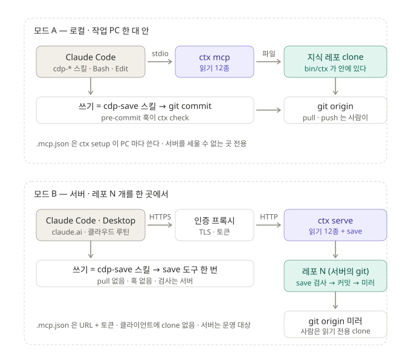

# CDP MCP 설계서 v1.0

2026-09-20 · 현재 v0.8.0 · 근거 문서 [`개념정리_MCP`](개념정리_MCP.md) ·
검토 경위 [`docs/dev/MCP_적용검토_설계서_v0.1`](../dev/MCP_적용검토_설계서_v0.1.md)

> `core/` 의 세 번째 소비자 `ctx-mcp` 를 만든다. 전송이 둘이다 — **모드 A(로컬 · stdio)** 는
> 작업 PC 의 지식 레포 clone 을 읽고, **모드 B(서버 · HTTP)** 는 서버가 레포 N 개를 들고
> 읽기와 `save` 를 받는다. 도구 · 리소스 · 명함 · 판정 코드는 두 모드가 같다.

---

## 0. 범위 · 용어

| 용어 | 뜻 |
|---|---|
| 호스트 | Claude Code · Claude Desktop · claude.ai 등 MCP 클라이언트 |
| 서버 | `ctx-mcp` — 이 문서가 만드는 것 |
| 모드 A | `ctx mcp` · stdio · 작업 PC · 레포 = 로컬 clone · 쓰기는 스킬 + git 훅 |
| 모드 B | `ctx serve` · Streamable HTTP · 서버 1대 · 레포 N 개 · 쓰기는 `save` 도구 |
| 명함 | 도구의 `description` + `inputSchema` |
| 단위 | 작업 기록 1건 + 파생 섹션 갱신 + 어휘 등재 — 한 커밋 |

범위 밖: 뷰어의 원격 모드 · 프로젝트 간 좌표 조회 · 문서별 권한 · OAuth 서버 구현.

---

## 1. 구조



```
core/                          판정 · 스캔 · 어휘 · 등록부 · 검증 · git         (변경 없음)
viewer/bin/ctx-cli.mjs         CLI  — 서브커맨드 mcp · serve 추가
viewer/bin/ctx-mcp.mjs         신설 — 도구 · 리소스 · prompts 정의 + 핸들러 (전송 무관)
viewer/bin/ctx-mcp-serve.mjs   신설 — 모드 B: HTTP 서버 · 레포 저장소 · 인증 · save
ops/lib/build-ctx.mjs          번들에 위 둘과 SDK 포함 → bin/ctx.mjs 하나
```

| | 모드 A | 모드 B |
|---|---|---|
| 프로세스 | 호스트가 세션마다 띄운다 | 상주 (LaunchAgent / systemd) |
| 전송 | stdio | Streamable HTTP (stateless) |
| 레포 | `bin/ctx` 가 든 지식 레포 자신 | `<root>/<name>/` 작업 트리 N 개 |
| 인증 | 없음 (자식 프로세스) | Bearer 토큰 · TLS 는 프록시 |
| 도구 | 읽기 11 | 읽기 11 + `save` |
| 쓰기 경로 | 스킬 → Edit/Write → git commit → 훅 `ctx check` | 스킬 → `save` → 서버 검사 → 커밋 → 미러 |
| 훅 | 그대로 | 없음 |
| 설치 | `ctx setup` 이 `.mcp.json` 을 PC 마다 쓴다 | `ctx setup --server` 가 URL + 토큰 헤더를 쓴다 |
| 런타임 | Node 또는 `cdp.exe` (shim) | Node ≥ 20 |

---

## 2. 공통 — 서버 정의

### 2.1 식별

| 필드 | 값 |
|---|---|
| `serverInfo.name` | `cdp` |
| `serverInfo.version` | `BUILT` (= `ctx version` 의 번들 시각) |
| `capabilities` | `tools` · `resources` (templates 포함) · `prompts` (§2.5 조건부) |
| `instructions` | 아래 문단. `<이름>` 은 레포 폴더명 |

```
<이름> 지식 레포의 도구다. 여기 있는 것이 정본이고 모델의 기억이 아니다.
· 시스템의 지금 상태·결정 이유를 물으면 기억으로 답하지 않는다.
· 좌표를 말로 받았으면 match 로 확정 → where 로 상태 → section 으로 그 섹션만.
  이유는 where 가 준 작업 id 로 work 를 연다.
· 문서 전체를 읽지 않는다. "후속 있음"을 "덮임"이라 쓰지 않는다.
  파생 남음이면 그 사실을 답에 적는다.
· 기록·갱신은 cdp-save 절차로만 한다.           ← 모드 A: "쓰기 도구는 없다" 로 대체
```

### 2.2 도구 — 읽기 11종

입력은 JSON Schema(zod). 출력 필드는 `ctx <명령> --json` 과 동일한 객체다.

| 도구 | 입력 | 출력 필드 | 명함 |
|---|---|---|---|
| `match` | `names: string[]` (1~20) | `[{ name, coord, kind: 이름\|값\|alias\|미등재, vocabLine, deprecated?, successor? }]` | 이름·alias·자유 표현을 정본 좌표로 대조한다. 테이블·화면·API·팩터·원천·용어를 말로 가리켰으면 좌표를 짐작하지 말고 먼저 이것으로 확정한다. `미등재` 는 어휘에 없다는 뜻이다 — 다른 좌표로 바꾸지 말고 그대로 보고한다. 폐기 좌표면 후속 좌표를 준다 |
| `where` | `coord: string` · `limit?: int (기본 5, 최대 50)` | `{ coord, normalized?, registry, section: { doc, anchor, line, end, applied, state: ok\|derive-pending\|missing }, works: [{ id, date, title }], total }` | 좌표의 지금 상태가 어느 관리 문서 어느 섹션에 있나, 마지막으로 반영된 작업, 그 좌표를 건드린 작업들. "지금 어떻게 돼 있나"는 이것. alias 를 주면 정본으로 바꾸고 `normalized` 에 적는다. `state` 가 `derive-pending` 이면 그 섹션은 아직 최신이 아니다 — 답에 그 사실을 적는다. 등록부에 없는 타입은 관리 문서가 없는 것이 정상이고 작업 기록이 유일한 근거다 |
| `section` | `coord: string` | `{ coord, doc, anchor, line, end, applied, heading, body }` | 관리 문서에서 그 좌표의 섹션 본문만 돌려준다. 문서 전체를 읽지 않는다. 섹션이 없으면 `body: null` 로 알린다 |
| `work` | `id: string` | `{ id, frontmatter, body, path }` | 작업 기록 본문. "왜 그렇게 정했나"는 관리 문서가 아니라 여기 있다. 한 기록에 좌표가 여럿이고 좌표마다 그 뒤 사정이 다르다 — 문서 단위로 "덮였다"고 판정하지 말고 좌표별로 `where` 를 본다 |
| `search` | `words: string[]` (1~10) · `limit?: int (기본 12, 최대 50)` | `[{ coord, hits: [word], docs: [path], works: [id] }]` | 말 → 좌표 후보. `match` 가 미등재를 냈을 때의 폴백. 본문은 싣지 않는다 — 후보를 고른 뒤 `section` 으로 읽는다. 유사도 검색이 아니다: 걸리지 않으면 없는 것이다 |
| `derive` | — | `{ pendingDerive: [...], brokenSections: [...] }` | 파생이 남은 섹션과 깨진 섹션. 이것이 비어야 커밋된다. 치우는 것은 `cdp-managed` 절차 |
| `apply` | `coord: string` | `{ coord, doc, anchor, lines: [string] }` | 파생할 섹션에 붙일 변경 줄 초안. 파일은 고치지 않는다 — 고치는 것은 `cdp-save` 안에서 사람이 승인한 뒤 |
| `check` | — | `{ ok, errors, warnings, findings }` | 커밋 가능한가. 커밋 때 같은 검사가 돈다 — 이 도구로 미리 본다 |
| `sync` | — | 모드 A `{ mode: "local", remote, behind, ahead, hooksPath }` · 모드 B `{ mode: "server", head, mirror: ok\|lag\|off }` | 원격과의 차이와 훅 설정 여부. 받지 않는다. 받을 것이 있으면 주입한 섹션이 최신이 아닐 수 있다고 알린다 |
| `brief` | — | `{ lines: [string, string] }` | 두 줄 요약 — 절차와 살아 있는 레포 상태 |
| `version` | — | `{ built, mode, repo }` | 이 번들이 언제 만들어졌나. 번들이 낡으면 옛 판정을 낸다 |

명함은 도구당 3~4문장. `term` 은 `match` 에 흡수. `setup` · `index` · `sync --pull` 은 도구가 아니다.

### 2.3 결과 형식 · 오류

```jsonc
// 성공
{ "content": [{ "type": "text", "text": "<JSON 문자열>" }], "structuredContent": { …같은 객체… } }
// 실패
{ "isError": true, "content": [{ "type": "text", "text": "{\"error\":{\"code\":\"E_CONFLICT\",\"message\":\"…\",\"detail\":{…}}}" }] }
```

| 코드 | 언제 | `detail` |
|---|---|---|
| `E_INPUT` | 스키마 위반 · 길이 초과 · 금지 문자 | 필드명 |
| `E_COORD` | 좌표 형식 오류 (`type:value` 아님 · `..` · 제어문자) | coord |
| `E_NOT_FOUND` | `work` id 없음 · 리소스 없음 | id / uri |
| `E_REPO` | 레포를 못 열음 · 스캔 실패 | path · cause |
| `E_AUTH` / `E_FORBIDDEN` | 모드 B — 토큰 없음/무효 · 권한 없음 | — |
| `E_EXISTS` | `save` — `work/<id>.md` 가 이미 있다 | id |
| `E_CONFLICT` | `save` — 섹션 `applied` 불일치 | `{ coord, expected, current }` |
| `E_CHECK` | `save` — `runBuiltinCheck` 오류 | `findings` |
| `E_GIT` | `save` — 커밋/미러 실패 | stderr 요약 |

### 2.4 리소스

| URI | 내용 | 목록 |
|---|---|---|
| `cdp://section/{coord}` | `section` 과 같음 (text/markdown) | 템플릿 |
| `cdp://work/{id}` | `work` 와 같음 | 템플릿 |
| `cdp://doc/{name}` | 등록부의 관리 문서 전체. `description` = `"<name> <크기>KB — 섹션 리소스를 우선 쓴다"` | 정적 (등록부 문서 수) |
| `cdp://index` · `cdp://vocab` · `cdp://managed` | `INDEX.md` · `_vocab.md` · `_managed.md` | 정적 |

작업 기록은 정적 목록에 올리지 않는다. `resources/list` 는 정적 항목만, `resources/templates/list` 는 템플릿 둘.

### 2.5 prompts

| 이름 | 인자 | 돌려주는 메시지 |
|---|---|---|
| `load` | `coord` | ① `.claude/skills/cdp-load/SKILL.md` 의 §1~§5 규칙 ② `sync` 결과 ③ `match` ④ `where` ⑤ `section` 본문 — 하나의 user 메시지 |
| `brief` | — | `brief` 두 줄 + "절차는 스킬 · 이 대화창에서는 읽기만" 한 줄 |

노출 규칙 `--prompts auto|always|never` (기본 `auto`): `auto` 는 `initialize.params.clientInfo.name` 이 Claude Code 이면 **내놓지 않는다**(값은 §8 픽스처로 확정). 절차 문장은 스킬 파일을 **읽어서** 낸다 — 따로 적지 않는다.

### 2.6 레포 로딩 · 재스캔 · 직렬화

- 첫 요청에 `loadRepo(root)` → 메모리. 요청마다 스탬프 계산: `_vocab.md` · `_managed.md` · `docs/*.md` · `work/*.md` 의 `(count, max mtime)` + `.git/HEAD` 의 mtime. 스탬프가 바뀌면 다시 `loadRepo` 하고 객체를 **통째로 교체**한다(부분 갱신 없음). 감시(chokidar)는 쓰지 않는다.
- 읽기 도구는 교체된 객체를 읽을 뿐 상태를 바꾸지 않는다 — 동시 실행 허용.
- `save`(모드 B)는 레포당 뮤텍스. 직렬화된다.

### 2.7 입력 검증 · 경로

- `coord`: `/^[a-z][a-z0-9_-]*:[^\s\x00-\x1f]{1,200}$/` · `..` 포함 금지.
- `id`: `/^\d{4}-\d{4}-[^\/\\\x00-\x1f]{1,120}$/`.
- 리소스 `name`: 등록부에 있는 파일명만. 파일 접근은 전부 `path.resolve(root, …)` 후 `root` 접두 검사.
- `words`·`names` 원소 ≤ 100자.

### 2.8 로그

| 모드 | 어디 | 무엇 | 안 적는 것 |
|---|---|---|---|
| A | stderr | 시작 · 레포 · 재스캔 · 오류 | 본문 · 검색어 · 좌표 |
| B | `<data>/logs/serve.log` 회전 3×1MB | 시각 · user · 도구명 · coord/id · ms · 결과 코드 | 본문 · 검색어(`search` 는 건수만) · 토큰 |

stdout 은 모드 A 에서 규약 전용 — `ctx-mcp.mjs` 는 `console.log` 를 쓰지 않는다.

---

## 3. 모드 A — 로컬 (stdio)

### 3.1 실행 · 레포 해결

```
bin/ctx mcp [--repo <경로>] [--prompts auto|always|never]
```

레포 해결 순서는 CLI 와 같다: `--repo` → `CDP_REPO` → `.claude/cdp.json` 상위 탐색 → **자기 위치**(`<repo>/bin/ctx.mjs` 의 부모). 프로세스는 호스트가 띄우고 죽인다. 유휴 종료 없음.

### 3.2 설치 — `ctx setup` 산출물

`ctx setup <작업레포>` 가 기존 산출물(스킬 사본 · CLAUDE 블록 · `.claude/cdp.json`)에 더해 다음을 쓴다.

**`<작업레포>/.mcp.json`** — PC 마다 절대경로 · 커밋하지 않는다.

```jsonc
// macOS · Linux
{ "mcpServers": { "cdp": { "type": "stdio",
    "command": "/Users/kjsa/Documents/GitHub/ezipez_cdp/bin/ctx", "args": ["mcp"] } } }
// Windows
{ "mcpServers": { "cdp": { "type": "stdio",
    "command": "cmd", "args": ["/c", "C:\\work\\ezipez_cdp\\bin\\ctx.cmd", "mcp"] } } }
```

- 기존 `.mcp.json` 이 있으면 `mcpServers.cdp` 키만 병합한다. 다른 서버는 건드리지 않는다.
- `.gitignore` 안내에 `.mcp.json` 한 줄을 추가한다(`cdp.json` 과 같은 이유).
- `inspect()` 가 `.mcp.json` 상태를 낸다: `command` 가 `cdp.json.knowledgeRepo` 와 일치 → 최신 · 불일치 → 갱신 필요 · 없음 → 미설치. 관리 > 작업 레포 화면에 열 하나 추가.
- `--dry` 는 `.mcp.json` 도 미리보기에 포함한다.

**`ctx setup --desktop`** — Claude Desktop 설정에 같은 항목을 병합한다.

| OS | 파일 |
|---|---|
| macOS | `~/Library/Application Support/Claude/claude_desktop_config.json` |
| Windows | `%APPDATA%\Claude\claude_desktop_config.json` |

키는 `mcpServers["cdp-<레포 폴더명>"]`. 파일이 없으면 만든다. 다른 키는 보존.

### 3.3 스킬 본문 규칙

스킬 머리의 `<repo>` 정의 줄 아래 한 문장 —

> `ctx` 호출은 MCP 도구 `cdp:*` 가 있으면 그것으로, 없으면 `<repo>/bin/ctx …` 로. 둘은 같은 함수다.

| 스킬 · 절 | 지금 | 도구 |
|---|---|---|
| cdp-load §0 | `ctx sync` | `sync` |
| cdp-load §2 · cdp-edit | `ctx where` → 섹션만 Read | `where` → `section` |
| cdp-load §5 | `ctx search` | `search` |
| cdp-work ① · cdp-save ② · cdp-import ③ | `ctx match` | `match` |
| cdp-save ④ · cdp-managed | `ctx derive` · `ctx apply` | `derive` · `apply` |
| 전부 | `git pull --ff-only` · Write/Edit · `git commit` | **그대로** |

훅(`.githooks/pre-commit`)은 CLI 를 그대로 쓴다.

### 3.4 에이전트

```yaml
tools: Read, Grep, Glob, mcp__cdp__match, mcp__cdp__where, mcp__cdp__section, mcp__cdp__work
```

셸 없이 정본만 읽는 에이전트의 `tools:` 형태. 어느 에이전트에 무엇을 줄지는 각 프로젝트가 정한다.

### 3.5 쓰기

없다. `save` 는 등록하지 않는다. 기록 · 파생 · 커밋 · push 는 스킬과 git 이 한다.

---

## 4. 모드 B — 서버 (HTTP)

### 4.1 실행

```
bin/ctx serve --root <레포들 폴더> [--bind 127.0.0.1] [--port 7374] --auth <auth.json>
              [--mirror] [--data <폴더>] [--prompts auto|always|never]
bin/ctx serve token  --auth <auth.json> --user <이름> [--write] [--repos a,b|*]      # 발급 · 1회 출력
bin/ctx serve token revoke --auth <auth.json> --user <이름>
```

Node ≥ 20 필수. `cdp.exe` 는 서버 모드를 지원하지 않는다. `--bind` 기본은 루프백 — 밖에서 오는 것은 프록시(§4.9)만.

### 4.2 레포 저장소

```
<root>/
  ezipez/      git 작업 트리 = 지식 레포 하나.  폴더명 = 레포 이름 = URL 조각
  dpms/
```

- 등록 = 폴더를 두는 것. `git clone <origin> <root>/<name>` 뒤 재시작 없이 다음 요청부터 인식(폴더 목록은 60초마다 갱신).
- 서버가 **유일한 작성자**다. 서버 트리에서 사람이 커밋하지 않는다.
- `--mirror`: 커밋 뒤 `git push origin HEAD` 를 비동기로. 실패는 로그 + `sync.mirror = lag`. 사람은 origin 을 **읽기 전용으로 clone** 해 폴더로 읽는다.
- 레포마다 `.claude/skills/` · `CLAUDE.md` 등 kit 파일이 있어야 `prompts` 와 `GET /kit` 가 동작한다(모드 A 와 같은 레포 구성).

### 4.3 엔드포인트

| 메서드 · 경로 | 인증 | 내용 |
|---|---|---|
| `POST /mcp/<name>` | Bearer | MCP Streamable HTTP. stateless — 세션 id 없음. 응답은 JSON 또는 SSE(SDK 결정) |
| `GET /mcp/<name>` · `DELETE /mcp/<name>` | — | 405 |
| `GET /healthz` | 없음 | `{ ok, built, repos: n, mirror: [{ name, lag }] }` |
| `GET /repos` | Bearer | 토큰이 볼 수 있는 레포 목록 |
| `GET /kit/<name>` | Bearer | 그 레포의 kit(스킬 · CLAUDE 블록 · TEMPLATE) zip — `ctx setup --server` 가 받는다 |

`X-Forwarded-For` 는 로그용으로만 읽는다. 요청 본문 상한 2MB(`save` 포함).

### 4.4 인증

`auth.json` —

```json
{ "tokens": [
  { "sha256": "9f2c…", "user": "kjsa", "write": true,  "repos": ["*"] },
  { "sha256": "41ab…", "user": "qa",   "write": false, "repos": ["ezipez"] }
] }
```

- 클라이언트: `Authorization: Bearer <토큰>`. 서버는 sha256 으로 조회. 원문 토큰은 어디에도 저장하지 않는다.
- 토큰 = 32바이트 난수 base64url. `token` 명령이 1회 출력하고 해시만 파일에 붙인다.
- `repos` 밖 → `E_FORBIDDEN`. `write: false` 인 토큰의 `save` → `E_FORBIDDEN`.
- `save.work.author` 는 토큰의 `user` 로 서버가 채운다. 클라이언트가 다른 값을 보내면 `E_INPUT`.
- TLS · 레이트리밋 · IP 제한은 프록시가 한다. 서버는 평문 HTTP 를 루프백에서만 듣는다.

### 4.5 `save` 도구

명함 — *"작업 단위 하나를 기록한다: 작업 기록 1건 + 그 작업이 바꾼 좌표의 관리 문서 섹션 + 신규 어휘. 검사를 통과해야 커밋된다. 섹션은 `section` 으로 읽었을 때의 `applied` 를 그대로 보내야 하며, 그 사이 바뀌었으면 거부된다."*

입력 —

```jsonc
{
  "work": {
    "id": "2026-0919-마스터단지-총주차대수-추가",     // YYYY-MMDD-slug · work/<id>.md 가 없어야 한다
    "title": "…",
    "date": "2026-09-19 22:10",                       // 시각까지. 날짜만이면 warning
    "touches": ["table:mart.마스터_단지"],             // 어휘에 있어야 한다 (vocab 등재 후 판정)
    "supersedes": null,                               // 선택
    "tags": [],                                       // 선택
    "body": "…"                                       // 프론트매터 없이 본문만
  },
  "sections": [
    { "coord": "table:mart.마스터_단지", "applied": "2026-0911-…", "body": "…" }   // 헤딩·applied 주석 없이 내용만
    // 새 섹션: "applied": null, "heading": "단지 마스터"  → 서버가 "## <값> — <heading>" 을 만든다
  ],
  "vocab": [
    { "coord": "factor:C019", "label": "신규 팩터", "aliases": ["…"] }          // 선택. 타입 섹션이 있어야 한다
  ]
}
```

처리 순서(레포 뮤텍스 안) —

```
1  권한       write 토큰 · repos 포함                                    아니면 E_FORBIDDEN
2  스키마     §2.7 형식 · body 에 "<!-- applied:" 포함 금지               아니면 E_INPUT
3  존재       work/<id>.md 없음                                          있으면 E_EXISTS
4  어휘       vocab 를 각 "## <type>" 섹션 끝에 "- `coord` — label\n  aliases: …" 로 붙인다 (메모리)
5  좌표       touches · sections.coord 가 어휘에 있고 등록부에 걸린다     아니면 E_INPUT
6  섹션       각 sections: 현재 applied == 보낸 applied                  아니면 E_CONFLICT { expected, current }
             치환 범위 = "## <값>" 헤딩 다음 줄 ~ 같은/상위 레벨 다음 헤딩 전.  헤딩은 유지, applied 주석은 서버가 <id> 로 쓴다
             새 섹션은 문서 끝(또는 등록부 규칙 위치)에 헤딩 + applied + body
7  기록       work/<id>.md = TEMPLATE 순서의 프론트매터(author = 토큰 user) + body
8  검사       runBuiltinCheck(갱신된 트리)                                error 있으면 파일 복원 후 E_CHECK { findings }
9  인덱스     INDEX.md · INDEX-by-coord.md 재생성
10 커밋       git add <바뀐 경로만> · git commit --author="<user> <<user>@cdp>" -m "<title>"    실패면 복원 후 E_GIT
11 미러       --mirror 면 비동기 push
```

응답 —

```json
{ "commit": "a1b2c3d", "id": "2026-0919-…", "sections": 1, "vocab": 0, "warnings": [], "mirror": "queued" }
```

규칙 — 기존 `work/*.md` 는 수정·삭제하지 않는다(정정은 `supersedes` 를 단 새 기록). 어휘 삭제 없음(폐기는 사람이 `deprecated` 표기). `_managed.md` 는 `save` 로 바꾸지 않는다.

### 4.6 읽기 도구 — 모드 B 차이

`sync` 만 다르다(§2.2). 나머지 11종은 동일. `prompts` 는 §2.5 규칙 그대로.

### 4.7 설치 — `ctx setup --server`

```
ctx setup --server https://cdp.example.com --repo ezipez <작업레포>
```

배포본(release)의 `bin/ctx` 로 실행한다(클라이언트에 지식 레포가 없다). 산출물 —

| 파일 | 내용 | 커밋 |
|---|---|---|
| `<작업레포>/.mcp.json` | `{ "mcpServers": { "cdp": { "type": "http", "url": "https://cdp.example.com/mcp/ezipez", "headers": { "Authorization": "Bearer ${CDP_TOKEN}" } } } }` | ○ (토큰은 환경변수) |
| `<작업레포>/.claude/cdp.json` | `{ "server": "https://cdp.example.com", "repo": "ezipez" }` | ✗ |
| `<작업레포>/.claude/skills/cdp-*` · `CLAUDE.md` 블록 | `GET /kit/ezipez` 에서 받은 것 | ○ |

`CDP_TOKEN` 은 PC 의 환경변수. 훅은 설치하지 않는다(`core.hooksPath` 안내 없음).

### 4.8 스킬 본문 규칙 — 모드 B

§3.3 의 문장에 한 줄을 더한다 —

> `save` 도구가 있으면 서버 모드다: pull 하지 않고, 커밋 대신 `save` 한 번으로 끝낸다.

| 스킬 · 절 | 모드 A | 모드 B |
|---|---|---|
| cdp-load §0 | `sync` → "받을 것 N건" 안내 | `sync` → 없음 (항상 origin HEAD) |
| cdp-save ① · cdp-import ① · cdp-edit ① · cdp-managed ① | `git pull --ff-only` | 생략 |
| cdp-save ③④ | Write · Edit | 본문과 섹션 내용을 **메모리에** 준비(파일 없음) · 사람 승인 |
| cdp-save ⑤ · cdp-import ⑥ · cdp-edit · cdp-managed | `git commit` → 훅 | `save({ work, sections, vocab })` · `E_CONFLICT` 면 `section` 다시 읽고 다시 |
| cdp-push | 코드 레포 | 무관 · 그대로 |

### 4.9 배포

**LaunchAgent** (`~/Library/LaunchAgents/com.cdp.serve.plist`)

```xml
<key>ProgramArguments</key>
<array><string>/usr/local/bin/node</string><string>/opt/cdp/bin/ctx.mjs</string>
  <string>serve</string><string>--root</string><string>/opt/cdp/repos</string>
  <string>--auth</string><string>/opt/cdp/auth.json</string><string>--mirror</string>
  <string>--data</string><string>/opt/cdp/data</string></array>
<key>KeepAlive</key><true/>
<key>StandardErrorPath</key><string>/opt/cdp/data/logs/serve.err</string>
```

**프록시** — 둘 중 하나.

```
# Caddy — TLS 자동
cdp.example.com { reverse_proxy 127.0.0.1:7374 }

# Cloudflare Tunnel — ingress
- hostname: cdp.example.com
  service: http://localhost:7374
```

**운영 항목** — `GET /healthz` 감시(ops 봇 헬스체크 목록에 추가) · `serve.log` 회전 · `auth.json` 0600 · 백업 = `--mirror` + `<root>` 디스크 스냅샷 · 갱신 = `bin/ctx.mjs` 교체 후 재시작(`/healthz.built` 로 확인).

### 4.10 이전

| 방향 | 절차 |
|---|---|
| A → B | 서버: `git clone <origin> <root>/<name>` · 클라이언트: `ctx setup --server …` (기존 `.mcp.json` 의 `cdp` 키가 HTTP 로 바뀐다) · 로컬 clone 은 지워도 된다 |
| B → A | `git clone <origin>` · `ctx setup <작업레포>` — 그 자리에서 모드 A |

형식이 같으므로 데이터 변환은 없다.

---

## 5. 프로토콜 세부

- SDK `@modelcontextprotocol/server` + `zod`. stdio 전송 · Streamable HTTP 전송 둘 다 SDK. esbuild 가 번들에 포함(순수 JS · SEA 영향 없음).
- 처리 메서드: `initialize` · `notifications/initialized` · `ping` · `tools/list` · `tools/call` · `resources/list` · `resources/templates/list` · `resources/read` · `prompts/list` · `prompts/get`. 나머지는 SDK 기본 응답.
- `protocolVersion` 협상은 SDK. 서버가 모르는 버전은 SDK 가 거절한다.
- HTTP 는 stateless(세션 id 없음). 도구 실행 중 진행 알림 없음. 응답 스트리밍은 쓰지 않는다.
- 취소(`notifications/cancelled`) 무시 — 모든 도구가 1초 안에 끝난다. `save` 는 취소 불가.

---

## 6. 보안

| | 공통 | 모드 A | 모드 B |
|---|---|---|---|
| 경로 | `root` 접두 검사 · `..` 거부 | | |
| 쓰기 | 읽기 도구는 파일을 바꾸지 않는다 | 쓰기 도구 없음 | `save` 만 · write 토큰만 · 레포 뮤텍스 |
| 리스너 | | 없음 | 루프백 + 프록시. 프록시 없이 `--bind 0.0.0.0` 이면 시작 시 stderr 경고 |
| 비밀 | | 없음 | 토큰 해시만 저장 · 로그에 토큰 없음 · `auth.json` 0600 |
| 로그 | 본문 · 검색어 안 남김 | | user · 도구 · coord/id · 결과 코드 |
| 본문 크기 | `section` · `work` 응답 상한 512KB — 넘으면 `E_INPUT`(`cdp://doc` 리소스로) | | 요청 2MB |

---

## 7. 빌드 · 릴리스

- `build-ctx.mjs`: entry 그대로 `ctx-cli.mjs`. `ctx-mcp.mjs` · `ctx-mcp-serve.mjs` · SDK · zod 가 같은 `ctx.mjs` 에 들어간다. `__CTX_BUILT__` 치환 그대로.
- `ctx version` 출력에 `mcp: stdio · http` 한 줄 추가.
- 배포본: `bin/ctx.mjs` 하나가 두 모드를 다 든다. 서버는 그 파일 + Node 로 돈다 — 별도 서버 패키지 없음.
- 번들 크기를 릴리스 로그에 적는다(현재 246KB 대비).
- `cdp.exe`: `ctx mcp` 는 동작해야 한다(§8) · `ctx serve` 는 "서버 모드는 Node 로" 메시지 후 exit 2.

---

## 8. 검증 항목

**공통**
```
□ where · match · derive · check · brief · version 의 tools/call 결과가 ctx <명령> --json 과 바이트까지 같다
□ 좌표 `..` · 절대경로 · 제어문자가 E_COORD / E_INPUT 으로 거부된다
□ 세션 중 work/ 에 파일이 생기면 다음 호출이 그것을 본다 (스탬프 재스캔)
□ 명함 11개 토큰 비용 실측 (세션 시작 컨텍스트 차이)
□ Claude Code 의 initialize (protocolVersion · clientInfo.name) 를 픽스처로 저장 · prompts auto 판정에 반영
□ tools: 를 제한한 에이전트가 Bash 없이 where 를 부른다
```

**모드 A**
```
□ /mcp 에 cdp 가 연결로 뜨고 tools/list 가 11건이다
□ mcp 모드에서 stdout 규약 밖 바이트 0 (로그는 stderr)
□ Node 없는 PC: shim → cdp.exe ctx mcp 로 stdio 가 열린다 (콘솔 서브시스템 제거 exe · 파이프 실측 · 안 되면 mcp 만 CONSOLE 빌드)
□ Windows .mcp.json: cmd /c … ctx.cmd mcp 로 연결된다
□ ctx setup --dry 에 .mcp.json 이 보이고, 적용 후 inspect 가 최신을 낸다
□ ctx setup --desktop 이 기존 claude_desktop_config.json 의 다른 키를 보존한다
```

**모드 B**
```
□ 토큰 없음 401 · 무효 401 · repos 밖 403 · read 토큰의 save 403
□ save 정상: 커밋 1개 · work 파일 · 섹션 applied 갱신 · INDEX 재생성 · 미러 push
□ save 충돌: 두 클라이언트가 같은 섹션 — 둘째가 E_CONFLICT 로 거부되고 트리가 깨끗하다
□ save 검사 실패: 파생 누락 · 미등재 좌표 → E_CHECK · 파일 복원 · 커밋 0
□ 같은 id 두 번 → E_EXISTS
□ 요청 2MB 초과 → 413
□ /healthz 가 프록시 없이 루프백에서 응답 · mirror lag 가 표시된다
□ ctx setup --server 가 GET /kit 로 스킬을 받아 넣고 .mcp.json 이 ${CDP_TOKEN} 을 쓴다
□ 서버 재시작 없이 <root> 에 레포 폴더를 추가하면 60초 안에 /repos 에 나온다
□ Desktop 대화창에서 load prompt 가 섹션까지 한 번에 넣는다 · Claude Code 에서는 /mcp-cdp-load 가 안 보인다
```

---

## 9. 설정 · 플래그 레퍼런스

| 자리 | 키 · 플래그 | 값 |
|---|---|---|
| `ctx mcp` | `--repo` · `--prompts` | 경로 · `auto\|always\|never` |
| `ctx serve` | `--root` · `--bind` · `--port` · `--auth` · `--mirror` · `--data` · `--prompts` | 폴더 · IP(기본 127.0.0.1) · 정수(기본 7374) · 파일 · 플래그 · 폴더(기본 OS 앱데이터) · 위와 같음 |
| `ctx serve token` | `--user` · `--write` · `--repos` · `revoke` | 이름 · 플래그 · `a,b\|*` |
| `ctx setup` | `--desktop` · `--server <url> --repo <name>` · `--dry` | |
| `.mcp.json` (A) | `mcpServers.cdp` | `{ type: stdio, command, args: [mcp] }` |
| `.mcp.json` (B) | `mcpServers.cdp` | `{ type: http, url: <server>/mcp/<name>, headers: { Authorization: "Bearer ${CDP_TOKEN}" } }` |
| `.claude/cdp.json` | A `knowledgeRepo` · B `server` + `repo` | |
| 환경변수 | `CDP_REPO`(A) · `CDP_TOKEN`(B) | |
| `auth.json` | `tokens[]` | `{ sha256, user, write, repos }` |

---

## 부록 A — `ctx-mcp.mjs` 골격

```js
import { McpServer } from '@modelcontextprotocol/server'
import { StdioServerTransport } from '@modelcontextprotocol/server/stdio'
import * as z from 'zod/v4'
import { loadRepo } from '../../core/repo.js'
import { resolveCoord } from '../../core/managed.js'
import { reconcile } from '../../core/vocab.js'
// … ctx-cli.mjs 와 같은 import

export function buildServer({ root, mode, prompts, user }) {
  const server = new McpServer({ name: 'cdp', version: BUILT })
  const repo = makeRepoCache(root)                 // §2.6 스탬프 재스캔

  const tool = (name, description, shape, run) =>
    server.registerTool(name, { description, inputSchema: z.object(shape) }, async (args) => {
      try {
        const r = await run(await repo(), args)
        return { content: [{ type: 'text', text: JSON.stringify(r) }], structuredContent: r }
      } catch (e) {
        return { isError: true, content: [{ type: 'text', text: JSON.stringify({ error: toError(e) }) }] }
      }
    })

  tool('match', CARD.match, { names: z.array(z.string().max(100)).min(1).max(20) }, matchImpl)
  tool('where', CARD.where, { coord: z.string(), limit: z.number().int().min(1).max(50).optional() }, whereImpl)
  // section · work · search · derive · apply · check · sync · brief · version
  if (mode === 'server') tool('save', CARD.save, SAVE_SHAPE, (r, a) => saveImpl(r, a, user))

  registerResources(server, repo)                  // §2.4
  if (prompts !== 'never') registerPrompts(server, repo, prompts)   // §2.5 — clientInfo 는 initialize 뒤 판정
  return server
}

// 모드 A 진입 (ctx-cli.mjs 의 mcp 서브커맨드)
export async function runStdio(opts) {
  const server = buildServer({ root: await resolveRepo(opts), mode: 'local', prompts: opts.prompts })
  await server.connect(new StdioServerTransport())   // stdout 은 여기서만 쓴다
}
```

## 부록 B — `save` 실물

```jsonc
// 요청
{"jsonrpc":"2.0","id":9,"method":"tools/call","params":{"name":"save","arguments":{
  "work":{"id":"2026-0919-마스터단지-총주차대수-추가","title":"마스터_단지 총주차대수 추가 · 도로명코드 조인",
          "date":"2026-09-19 22:10","touches":["table:mart.마스터_단지"],"tags":[],
          "body":"배치6이 지번 조인으로 71%에서 멈춘 원인은 …"},
  "sections":[{"coord":"table:mart.마스터_단지","applied":"2026-0911-배치6-후속-주차장전국-전주정비-백필-D003재계산",
               "body":"**정의** `mart.마스터_단지` · TABLE · 컬럼 58 …\n\n| 컬럼 | … |\n| 총주차대수 | int | … |"}],
  "vocab":[]}}}

// 응답
{"jsonrpc":"2.0","id":9,"result":{"content":[{"type":"text","text":"{\"commit\":\"a1b2c3d\",\"id\":\"2026-0919-마스터단지-총주차대수-추가\",\"sections\":1,\"vocab\":0,\"warnings\":[],\"mirror\":\"queued\"}"}],
  "structuredContent":{"commit":"a1b2c3d","id":"2026-0919-마스터단지-총주차대수-추가","sections":1,"vocab":0,"warnings":[],"mirror":"queued"}}}

// 충돌
{"jsonrpc":"2.0","id":9,"result":{"isError":true,"content":[{"type":"text","text":"{\"error\":{\"code\":\"E_CONFLICT\",\"message\":\"섹션이 읽은 뒤 바뀌었다\",\"detail\":{\"coord\":\"table:mart.마스터_단지\",\"expected\":\"2026-0911-…\",\"current\":\"2026-0919-…\"}}}"}]}}
```
