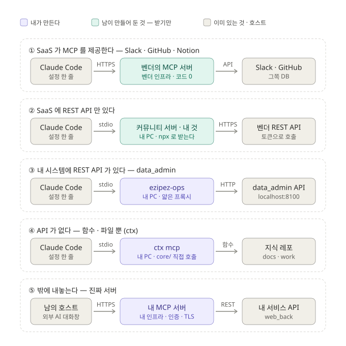

# MCP 란 무엇인가 — 이 레포의 말로
> **v1.0 이후** — CDP 의 MCP 는 HTTP 하나다(stdio · 모드 A 없음) · 도구 12 — [`CDP_MCP_설계서_v2.0.md`](CDP_MCP_설계서_v2.0.md).

CDP 개념 정리 · 팀 공유용 · 2026-09-20

> [`CDP_MCP_설계서_v1.0`](CDP_MCP_설계서_v1.0.md) 의 **근거 문서**다. 설계서를 읽으면 반드시
> 나오는 질문 — *"MCP 가 스킬인가, API 서버인가, 서버가 있어야 하나"* — 에 답한다.
> 설계서를 읽지 않았어도 이 문서만으로 이해되도록 썼다.

---

## 0. 한 줄

**MCP 는 규약(프로토콜)이다.** git 이 규약이고 원격이 상대이듯, MCP 는 "모델을 돌리는
프로그램(호스트)"과 "도구를 가진 프로그램(서버)"이 대화하는 정해진 말투다. 스킬로
구현하는 것이 아니라 **프로그램 하나**로 구현한다.

```
 모델                            도구 목록을 보고 "이걸 부르자"고 정한다
   │
 호스트  Claude Code · Desktop     서버를 띄우고 · 권한을 묻고 · 결과를 모델에 넣는다
   │  JSON-RPC (initialize · tools/list · tools/call)
 MCP 서버  작은 프로그램            도구를 "이름 + 설명 + 입력 스키마"(명함)로 내놓고, 불리면 실행한다
   │
 실제 시스템  core/ · DB · HTTP API
```

**서버 안에 LLM 은 없다.** 함수 몇 개를 규약대로 포장한 것이다. Claude Code 에서
이름이 `mcp__<서버>__<도구>` 인 도구가 전부 MCP 서버다.

규약이 정한 세 가지 —

| | 시작하는 쪽 | 들어오는 것 | Claude Code 에서 | 지식 레포로 치면 |
|---|---|---|---|---|
| **tools** | 모델이 명함을 보고 | 데이터 | `mcp__cdp__where` | `bin/ctx` 명령 |
| resources | 사람이 첨부 | 데이터 | `@` 멘션 | 관리 문서의 섹션 |
| prompts | 사람이 고른다 | 절차(+데이터) | `/mcp-cdp-load` | MANUAL 의 절차 = 스킬 |

---

## 1. "서버"는 이름만 서버다 — 전송 둘

| 전송 | 실체 | 언제 |
|---|---|---|
| **stdio** | 호스트가 **자식 프로세스로 띄우고 stdin/stdout 으로** 대화. 포트 없음 · 네트워크 없음 · 세션이 끝나면 같이 죽는다 | 로컬 도구 — 파일 · 로컬 DB · CLI 래퍼 · `ctx`. 커뮤니티 서버 대부분 |
| **HTTP** (Streamable HTTP · 예전 이름 HTTP+SSE) | URL 로 붙는 원격 서버. 인증 · TLS | SaaS 의 `https://…/mcp` · 여러 사람이 공유하는 서버 |

두 전송이 나르는 메시지는 같다. **전송은 호스트의 사정이지 모델의 사정이 아니다** —
모델 쪽에서는 둘 다 `mcp__서버__도구` 로 보인다.

stdio 로 보면 `bin/ctx` 와 같은 프로그램이다. `ctx where …` 는 한 번 답하고 죽는데,
MCP 서버는 세션 동안 살아서 계속 답한다 — 차이는 그것과 **명함**뿐이다.

HTTP 쪽 실물은 **엔드포인트 하나에 POST 만**이다. REST 처럼 리소스마다 URL 이 갈리지
않는다 — 어느 도구를 부르는지는 URL 이 아니라 몸통 안 `method` 에 있다.

```
POST /mcp/ezipez
Authorization: Bearer <토큰>
Accept: application/json, text/event-stream

{"jsonrpc":"2.0","id":3,"method":"tools/call","params":{"name":"where","arguments":{…}}}
```

stdio 가 전선으로 나르던 그 줄이 그대로 body 에 들어간다. **Streamable** 인 까닭은 같은
POST 의 응답이 두 모양이어서다 — `application/json` 한 방, 또는 응답 본문을 열어둔 채
흘리는 `text/event-stream`(SSE). 서버가 고르므로 클라이언트는 `Accept` 에 둘 다 건다.
SSE 가 필요한 것은 오래 걸리는 도구의 진행률 · 로그 · 서버→클라이언트 역요청 때문이고,
`ctx` 의 읽기 도구는 전부 한 방이라 JSON 으로 끝난다.

규약에는 `GET`(서버가 먼저 말 거는 상시 SSE 채널) · `DELETE`(세션 종료)도 있다. 세션을
들지 않는 stateless 서버는 둘 다 필요 없다. 예전 이름 `HTTP+SSE` 는 엔드포인트가
둘이었다 — GET `/sse` 로 채널을 열고 POST `/messages` 로 보내기. 하나로 합치고 SSE 를
선택으로 내린 것이 Streamable HTTP 다.

**전송과 데이터 위치는 별개다.** stdio 서버가 뒤에서 원격 REST API 를 부를 수 있고
(GitHub MCP 가 그렇다), HTTP 서버가 로컬 파일을 낼 수도 있다.

---

## 2. 세션에서 실제로 일어나는 일

```
① 세션 시작   호스트가 .mcp.json 에 적힌 명령을 띄운다          node ctx.mjs mcp
② 목록 요청   호스트 → 서버   tools/list
             서버 → 호스트   [{ name: "where", description: "좌표의 상태가 어느 문서 어느 섹션에",
                                inputSchema: { coord: string } }, …]                ← 명함
③ 합류        그 목록이 Read · Bash 옆에 mcp__cdp__where 로 붙는다.  모델은 구분을 못 한다
④ 호출        모델이 고르면   호스트 → 서버   tools/call { name: "where", arguments: { coord: "table:mart.마스터_단지" } }
             서버 → 호스트   { content: [{ type: "text", text: "…" }] }   → 모델 컨텍스트로
```

실물 —

```jsonc
{"jsonrpc":"2.0","id":1,"method":"initialize","params":{"protocolVersion":"…","clientInfo":{"name":"…"},"capabilities":{}}}
{"jsonrpc":"2.0","id":1,"result":{"protocolVersion":"…","serverInfo":{"name":"cdp","version":"2026-09-19 21:15"},
  "capabilities":{"tools":{},"resources":{}},"instructions":"… 지식 레포의 읽기 도구다. …"}}

{"jsonrpc":"2.0","id":2,"method":"tools/list"}
{"jsonrpc":"2.0","id":2,"result":{"tools":[{"name":"where","description":"좌표의 지금 상태가 …",
  "inputSchema":{"type":"object","properties":{"coord":{"type":"string"}},"required":["coord"]}}, …]}}

{"jsonrpc":"2.0","id":3,"method":"tools/call","params":{"name":"where","arguments":{"coord":"table:mart.마스터_단지"}}}
{"jsonrpc":"2.0","id":3,"result":{"content":[{"type":"text","text":"{\"section\":{\"applied\":\"2026-0911-…\",\"total\":51,…}}"}]}}
```

②의 **설명과 스키마가 핵심**이다. API 서버는 "호출법을 이미 아는 프로그램"이 부르지만,
MCP 는 "호출법을 모르는 모델"이 부를 수 있게 **도구가 자기를 설명한다.** 권한 확인 ·
승인 · 결과 표시는 호스트가 한다.

---

## 3. 스킬 · MCP · API 서버 — 셋은 겹치지 않고 쌓인다

| | 정체 | 코드가 도나 | CDP 에서 |
|---|---|---|---|
| **스킬** | 절차 문서(markdown). 모델이 읽고 **따라 한다** | 안 돈다 | `cdp-work` · `cdp-load` · `cdp-save` |
| **MCP 서버** | 도구를 내놓는 프로그램. 모델이 **부른다** | 돈다 | `ctx mcp` |
| **API 서버** | 프로그램·브라우저용 HTTP 엔드포인트 | 돈다 | 뷰어의 `/api/*` |

```
스킬 본문:  "<repo>/bin/ctx where <좌표> 를 실행하고 상태 줄을 읽어라"
   → 모델이 Bash("…/bin/ctx where table:…") 를 부른다 → 텍스트를 눈으로 파싱

스킬 본문:  "where 를 부르고 status 를 읽어라"
   → 모델이 where({coord:"table:…"}) 를 부른다 → JSON 이 온다
```

**절차는 스킬, 도구는 MCP, 결정론적 보증은 훅(또는 서버).** 스킬은 "언제 · 어떤 순서로 ·
무엇을 확인하고"를 갖고, MCP 는 "그 한 단계를 실행하는 함수"를 갖는다.

명령만 쥔 사람은 pull 없이 커밋한다. 훅이 파생 누락은 잡지만 좌표를 잘못 고른 것과
"왜"가 빠진 본문은 못 잡는다. 그래서 절차는 스킬에 남고, **스킬이 없는 자리(대화창)
에서는 쓰기를 하지 않는다.** 사람이 부르는 방식도 안 바뀐다 — "기록해" 라고 말하거나
`/cdp-save`. 스킬은 그 안에서 `ctx` 줄만 MCP 호출로 바꾼다.

**그런데 HTTP 로 띄우면 API 서버와 똑같아 보인다 — 맞다.** 전송 층에서는 같은 것이다.
JSON 받아 JSON 뱉는 POST 엔드포인트고 거기에 새 기술은 없다. "RPC 에 이름만 새로
붙였다"는 말이 돌고, 전송만 놓고 보면 틀리지 않았다. 차이는 전선에 없다 — **호출자에
있다.**

뷰어의 `/api/*` 를 부르는 것은 뷰어 프론트엔드다. 개발자가 스펙을 보고 fetch 를 짜
넣었고, 응답 필드명을 알며, 스펙이 바뀌면 코드를 고친다. **호출법이 클라이언트 코드에
박혀 있다.** MCP 호스트에는 그것이 없다. Claude Code 는 `where` 라는 도구가 존재한다는
것을 모른 채 출시됐고, 붙어서 `tools/list` 로 **런타임에 물어본 뒤** 그 명함을 모델에게
넘긴다. 그래서 규약이 고정한 것은 URL 도 필드도 아니라 **자기소개하는 방법**이다.

| | API 서버 | MCP 서버 |
|---|---|---|
| 호출자 | 사람이 짠 프로그램 | 모델 |
| 호출법을 아는 때 | 빌드 타임 — 코드에 박힌다 | 런타임 — `tools/list` 로 묻는다 |
| 규약이 정한 것 | 없다 — 엔드포인트는 만든 사람 마음 | 목록 묻는 법 · 명함 모양 · 결과 포장 |
| 설명이 사는 곳 | 사람이 읽는 문서 — 런타임에 없다 | `description` — 매 요청 모델 앞에 놓인다 |
| 늘어날 때 | 클라이언트마다 다시 짠다 (M×N) | 호스트가 아무 서버에나 붙는다 (M+N) |

차이가 실제로 드러나는 자리는 **명함 문구**다. 설계서의 `where` 명함에는 이런 줄이 있다 —
*"`state` 가 `derive-pending` 이면 그 섹션은 아직 최신이 아니다 — 답에 그 사실을 적는다."*
`match` 에는 *"`미등재` 는 어휘에 없다는 뜻이다 — 다른 좌표로 바꾸지 말고 그대로
보고한다."* **API 문서에는 저런 문장을 쓰지 않는다.** 필드 설명이 아니라 호출자가 멋대로
추론할까 봐 미리 막는 지시다. 사람이 짠 코드는 지어내지 않으니 필요가 없었을 뿐이다.
명함이 도구당 3~4문장인 까닭이 그것이다 — **스키마가 아니라 설득이다.**

뒤집어 물으면 선명하다. 모델에게 그냥 `/api/*` 를 주면 안 되나? 된다. 대신 ① 어느
엔드포인트를 노출할지 고르고 ② 각각을 모델이 알아들을 문장으로 쓰고 ③ 프롬프트에 끼워
넣고 ④ 응답 파싱을 시키고 ⑤ 승인 UI 를 붙여야 한다. **MCP 는 그 다섯을 한 번
표준화해둔 것**이고 그 이상도 이하도 아니다. 값어치는 새로움이 아니라 남들도 같은 규약을
지킨다는 데 있다 — HTTP 가 그랬듯이.

---

## 4. Bash 와 stdio — 층이 다르다

Bash 는 *모델이 쥐는 도구*이고, stdio 는 *프로세스의 배관*이다.

**셸**(`zsh` · `bash` · `cmd`)은 글자 한 줄을 받아 해석해서 프로그램들을 실행하는
프로그램이다 — 따옴표 · `$VAR` · `*` · `|` · `;`. **Bash 도구 = 모델이 쓴 문자열 한 줄을
셸에 준다.** 호스트가 할 수 있는 검사는 그 문자열을 패턴으로 보는 것뿐이다.

**stdio** 는 모든 프로세스가 태어날 때 받는 통로 셋이다.

```
0  stdin    들어오는 글자
1  stdout   내보내는 글자
2  stderr   오류·로그 — 1 과 섞이지 않는다
```

부모가 자식을 띄우면 이 셋에 파이프를 꽂는다. 권한도 보안 장치도 아니다 — **전선이다.**
모델은 이 전선을 보지 못한다.

**Bash 도구도 stdio 로 돈다.** 같은 전선 위로 가는 것이 다를 뿐이다.

| | Bash 도구 | MCP 서버 |
|---|---|---|
| 어떤 프로그램이 도나 | **모델이 문자열로 정한다** — 무엇이든 | **사람이 `.mcp.json` 에 정한다** — 하나 |
| 전선 위로 가는 것 | 셸이 해석할 자유 문자열 | 정해진 이름 + JSON 인자 |
| 모델이 할 수 있는 것 | 셸이 할 수 있는 전부 | 그 프로그램이 명함으로 내놓은 도구만 |
| 권한의 단위 | 문자열 패턴(`Bash(psql *)`) | 도구 이름(`mcp__cdp__where`) |
| 프로세스 | 호출마다 | 세션당 하나 |

**stdio 라서 안전한 게 아니다. 서버가 내놓은 도구가 읽기뿐이라서 안전하다.** 경계는
전선이 아니라 명함에 무엇을 올렸나다. 그리고 MCP 는 stdout(1) 으로만 규약을 주고받으므로
서버의 로그는 반드시 stderr(2) 로 — stdout 에 한 줄 섞이면 연결이 깨진다.

---

## 5. 상황별 — 누가 서버를 만드나



| 상황 | 서버는 누가 | 전송 | 내가 하는 일 |
|---|---|---|---|
| ① SaaS 가 MCP 를 **제공한다** (Slack · GitHub · Notion) | 벤더 | HTTP | URL 등록 + OAuth. **코드 0** |
| ② SaaS 에 REST API 만 있다 | 나, 또는 커뮤니티가 이미 (`npx -y …`) | 대개 **stdio** | 얇은 서버 하나, 또는 받아서 등록 |
| ③ 내 시스템에 REST API 가 있다 | 나 | 운영자용이면 stdio | 도구 → API 호출로 번역하는 프록시 |
| ④ API 가 없다 — 함수 · 파일 뿐 (`ctx`) | 나 | stdio | 서버가 함수를 직접 부른다 |
| ⑤ 밖에 내놓는다 | 나 | HTTP | 인증 · TLS · 운영이 딸린 **진짜 서버** |

**호스트 칸은 다섯 줄 다 "설정 한 줄"이다.** Claude Code 에 만드는 것은 어느 상황에도
없다 — 호스트 쪽 규약은 이미 구현돼 있다. **API 는 있어도 되고 없어도 된다.** 만드는
것은 서버(핸들러 + 명함)이고, 그것이 어디서 도느냐가 stdio/HTTP 를 정한다.

①의 "설정 한 줄" 실물 —

```bash
claude mcp add --transport http notion https://mcp.notion.com/mcp     # URL 을 적는다
claude mcp login notion                                                # OAuth
claude mcp list                                                        # ✔ Connected

claude mcp add --transport stdio cdp -- /path/to/knowledge-repo/bin/ctx mcp   # ④ — 띄울 명령을 적는다
```

같은 명령, 다른 인자 — **URL 이냐 실행할 명령이냐.** claude.ai 커넥터로 켠 서버(Slack ·
Gmail)는 명령조차 없이 Claude Code 에 자동으로 나타난다.

---

## 6. 프록시 · 루프백

**프록시** — 대신 가서 물어봐 주는 것. 요청을 받아 그대로 넘기고 답을 그대로 돌려준다.
얇은 프록시는 번역만 한다 — 도구 이름·인자 ↔ URL·쿼리, 응답 → `content`. **판정 · 계산은
하지 않는다**(두 번째 계산기가 된다). 그러면서 문 앞에 서서 **토큰을 대신 붙이고, 노출
범위를 가리고, 해석 주석을 단다** — 그것이 프록시를 두는 이유다. `npm run dev` 의
`/api` 프록시, `bin/ctx` 가 node/exe 를 고르는 shim 이 이미 그 모양이다.

**루프백** — `127.0.0.1` · `::1` · `localhost`. 자기 자신에게 되돌아오는 주소라 다른
기계에서는 닿지 않는다. 그러나 **같은 PC 의 다른 프로그램**(브라우저에 열린 외부 페이지의
자바스크립트)은 막지 못한다 — 그래서 로컬 리스너에는 토큰 · Origin · Host 검사가 따로
필요하다. **stdio 는 리스너가 없어서 둘 다 필요 없다** — 루프백보다 한 단계 안쪽이다.

---

## 7. 도구는 확률, prompt 는 확정

모델이 도구를 부르는 근거는 **명함(description)** 이다. 스킬도 같다 — `cdp-save` 의
`description` 을 보고 "기록해"에 걸린다. 그래서 서버 설계의 실체는 `registerTool` 스무
줄이 아니라 **명함 문구**와 서버가 초기화 응답에 실어 보내는 **instructions**(호스트가
시스템 프롬프트에 넣는 짧은 규칙)다.

도구는 매 순간 모델이 "부를까"를 다시 정한다 — 명함이 흐리면 기억으로 답한다.
확정이 필요하면 **사람이 시작하는** 둘을 쓴다.

| | 시작하는 쪽 | 강제성 |
|---|---|---|
| 스킬 description · 도구 명함 | 모델이 말을 보고 | 확률 |
| `/cdp-save` · **MCP prompt**(`/mcp-cdp-load` · Desktop `+` 메뉴) · `@` 리소스 | **사람** | **확정** |

prompt 핸들러는 서버 코드라서 절차 문장만이 아니라 **데이터까지 뽑아** 한 번에 돌려줄 수
있다 — `load(coord)` 가 sync → match → where → section 을 돌려 결과와 규칙을 한 메시지로.
대화창의 스킬이 prompt 다.

---

## 8. 무엇이 오가나 — 조각 단위

주고받는 단위는 "문서 전문"이 아니라 **좌표가 가리키는 조각**이다.

| 방향 | 무엇 | 실측 (ezipez_cdp · 2026-09-20) |
|---|---|---|
| 받기 `where` | 메타 — 문서 · 섹션 위치 · `applied` · 작업 목록 | 수백 바이트 |
| 받기 `section` | 관리 문서의 **그 섹션 본문만** | 2,209자 ~ 8,017자 |
| 받기 `work` | 작업 기록 **한 건** | 중앙값 7KB · 평균 11KB · 최대 118KB (900건) |
| 보내기 `save` | 새 기록 전문 + 바뀐 섹션 전문(각각) + 어휘 줄 | 수 KB ~ 수십 KB |

관리 문서 전체(합계 1MB · 팩터정의서 245KB)를 내려받는 일은 없다. 모델이 받는 바이트는
로컬에서 그 섹션만 `Read` 하는 것과 같다 — 오는 길만 다르다. 클라이언트에 남는 것은 없다.

---

## 9. 흔히 헷갈리는 것

- **서버는 "언제 쓸지"를 정하지 않는다.** 설명을 보고 모델이 정한다. 절차가 필요한 일은 스킬·CLAUDE.md 의 몫이다.
- **항상 켜져 있는 데몬이 아니다**(stdio). 세션이 띄우고 세션이 끝나면 죽는다. 운영할 서비스가 늘지 않는다.
- **API 서버를 없애는 게 아니다.** 사람·브라우저는 API 로, 모델은 MCP 로 — 같은 코드에 통로를 하나 더 낸다.
- **HTTP 로 띄운 MCP 는 API 와 전송이 같다.** 같아 보이면 잘못 본 것이 아니다. 다른 것은 전선이 아니라 호출자 — 런타임에 명함을 묻느냐다(§3).
- **MCP 규약을 Claude Code 에 만드는 게 아니다.** 만드는 것은 서버이고 Claude Code 에는 설정 한 줄이다.
- **stdio = 로컬 데이터가 아니다.** 전송은 호스트와 서버 사이의 통로이고, 서버가 뒤에서 무엇과 이야기하는지는 별개다.
- **원격이 항상 더 최신인 게 아니다.** 원격은 origin 의 HEAD 를 본다. 작성자 본인의 미push 커밋은 로컬만 안다.
